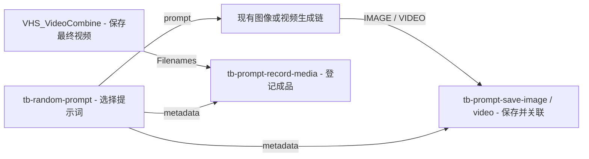

## MOSS 提示词增强

新增 `ToolBox/MOSS` 下的 `tb-moss-prompt-enhancer`，保留旧节点类型 `MOSSPromptEnhancer`。复用已有CUDA llama-cpp-python，支持自然语言或布局JSON增强、官方校验编译，不依赖LLM Text Processor或CLI；可选库在执行时加载，未安装时不影响其他节点注册。

[使用、依赖与迁移说明](docs/moss_prompt_enhancer.md) · [示例工作流](examples/moss_prompt_enhancer/README.md) · [上游来源](nodes/moss_prompt_enhancer/UPSTREAM.md)。新增06：参考图经llama-cpp视觉模型反推为分块中文提示词，再由MOSS生图。升级时停用独立增强器插件，避免重复注册。

English: MOSS prompt enhancement now lives in ToolBox, retaining the legacy workflow identifier and reusing the existing Python inference library. See the linked documentation and examples.

## 3DGS：H3单图转高斯场景

提供 `LocalCOLMAPDataset`、`LocalVideoFrames`、`LocalBrushTrain`、`LocalPLYFile` 四个节点，位于 `ToolBox/3DGS`。节点始终注册，PyCOLMAP和Brush在执行时检查；不会自动安装运行依赖。

[原理、安装与操作](docs/3dgs/README.md) · [四套工作流与示例](examples/3dgs/README.md)。运行依赖由Wheels-Containerfiles的 `3dgs-v1` Release提供；ComfyUI-Custom使用 `INSTALL_3DGS=true` 在构建时安装。

# 🧰 ComfyUI-ToolBox

这是一个为 ComfyUI 设计的综合工具盒，旨在通过预设化、模块化的节点提升工作流的效率。

## FLUX.2 Klein 增强与身份迁移

内置原 Flux2Klein Enhancer 的全部 **16 个节点**，统一位于 `ToolBox/Flux2Klein`：文本增强、分段编码、参考图控制、多参考 latent、遮罩、颜色锚定、身份引导、四版身份特征迁移和实验采样器。保留原节点 ID、显示名称、参数和计算逻辑，已有工作流可继续使用；请停用独立的 `ComfyUI-Flux2Klein-Enhancer` 插件，避免重复注册。

节点代码随 ToolBox 安装，不再单独下载原仓库；模型和示例中其他插件仍需自行准备。本次不修改外部镜像构建配置。

[使用说明](docs/flux2_klein.md) · [八份原始示例与依赖说明](examples/flux2_klein/README.md)。

## VAE 去网格（DeGrid）

`ToolBoxVAEDeGrid`（`tb-vae-degrid` / `tb-VAE去网格`）去除 Qwen Image、Qwen Image 2.1、Wan 2.1 VAE 解码中的 2px 网格。支持逐图自动检测与校准、手动修正限制、干净图原像素透传、网格放大预览和中英文执行状态；无需新模型或额外依赖。

连接：`VAE Decode → ToolBoxVAEDeGrid → 锐化 / 放大 / 保存`。应在任何缩放或修复前使用，不自动改变已有工作流。

[使用说明](docs/degrid.md) · [对比工作流](examples/degrid/01-去网格对比.json)。

## 独立丝袜插件

丝袜纹理、材质图层与编辑器已迁入独立项目 [ComfyUI-StockingTexture](../ComfyUI-StockingTexture/README.md)，不再随 ToolBox 加载。请单独安装该插件。

## 素材库

新增 `ToolBox/Media` 下的 `tb-media-library`（节点类型 `ToolBoxMediaLibrary`）。顶部“素材库”直接打开图库，选中文件并点击“使用此文件”后，在当前画布中心添加路径节点；节点内“浏览素材库”只更新该节点。输出 `path: STRING` 为服务器原文件路径，选择已有文件不会复制素材。

支持图像、视频、音频、文本及其他文件的预览、元数据、目录浏览、上传、图片粘贴及文件管理。使用 `/toolbox/media-library` 接口，与提示词、Skill 和模板共用插件目录下的 `data/prompts.sqlite3`，素材表使用 `media_*` 前缀；预览缓存仍位于实际用户目录的 `tb_media_library/cache/`。从当前 input/output/temp 按需索引，不读取独立版素材库的数据。

[完整使用说明](docs/media_library/README.md) · [开发与测试](docs/media_library/development.md)。

## 🚀 核心功能：尺寸管理 (Size Management)
### tb-latent-size (ToolBoxLatentSize)

该节点解决了在不同宽高比（Aspect Ratio）之间切换时，手动计算像素值的繁琐过程。它内置了竖屏、方图和横屏等常用比例的多档分辨率预设；具体尺寸需根据所用模型和显存选择，部分预设比例会因像素对齐而略有偏差。

- **动态联动**：选择比例（如 9:16）后，分辨率选项会自动更新为该比例下的推荐像素值。
- **自定义尺寸**：选择“自定义尺寸”后，可直接输入宽度和高度。
- **8像素对齐**：所有预设均严格遵循 8×8 像素对齐要求。
- **纯数值输出**：仅输出 width 和 height 整数值，可自由连接至 Empty Latent 或 Upscale 节点。

### 节点参数说明
| 参数名     | 类型           | 描述                                         |
|------------|----------------|----------------------------------------------|
| ratio      | Combo (下拉框) | 预设比例（9:16 竖屏、1:1 方图、16:9 横屏等）或自定义尺寸 |
| resolution | Combo (下拉框) | 基于选定比例的具体分辨率选项，最高扩展到 4096 档 |
| custom_width | INT | 自定义尺寸模式下输出的宽度，范围 8-4096 |
| custom_height | INT | 自定义尺寸模式下输出的高度，范围 8-4096 |

## 🎲 随机提示词 (Random Prompt)
### tb-random-prompt (ToolBoxRandomPrompt)

该节点从本地 SQLite 数据库中按 seed 稳定抽取一条提示词，可按语言、媒体类型、提示词类型、NSFW、格式、动态性、标签和宽高过滤，输出 `id`、`prompt`、`width`、`height` 和 `metadata`。

首次使用前运行导入脚本：

```bash
python3 scripts/import_prompts.py --language zh --media-type image --prompt-type natural --nsfw --content-format plaintext --static
```

默认会读取插件根目录下的 `prompts/` 目录，并生成 `data/prompts.sqlite3`。导入脚本会提取记录 id 和提示词内容；如果提示词跨多行，会拼接成同一行写入数据库。可使用 `--input prompt.txt` 指定单个文件。`--tags` 是批量标签，会绑定到本次导入的每一条提示词；如确实需要批量标签，需同时传入 `--apply-tags-to-all`。

### 节点参数说明
| 参数名 | 类型 | 描述 |
|--------|------|------|
| seed | INT | 可复现随机种子；`fixed` 保持相同结果。生成后控制设为 `randomize` 时，无论完整执行还是点击节点局部运行，都会自动更新 seed 并重新抽取；由于随机取样允许重复，仍可能低概率连续得到同一提示词 |
| language | Combo | `全部`、`zh`、`en` |
| media_type | Combo | `全部`、`image`、`video`、`audio`、`music` |
| prompt_type | Combo | `全部`、`natural`、`danbooru` |
| safety | Combo | `全部`、`nsfw`、`safe` |
| content_format | Combo | `全部`、`plaintext`、`json` |
| dynamic | Combo | `全部`、`dynamic`、`static` |
| tags | STRING | 可选，逗号分隔；多个标签需要全部匹配 |
| match_size | BOOLEAN | 是否按数据库记录中的建议宽高过滤；不会搜索真实图片文件 |
| width / height | INT | 仅在启用 match_size 时用于匹配数据库记录的建议宽高，默认 1024×768；输出宽高来自抽中的记录 |

### tb-prompt-writer (ToolBoxPromptWriter)

该节点可在 ComfyUI 页面中将一条提示词及其元数据写入本地数据库，并输出 `id`、`prompt`、`metadata`。写入时会根据去除首尾空白后的 `prompt` 计算 SHA-1 `shasum`：`id=0` 时更新相同 `shasum` 中 ID 最小的记录，不存在时创建新记录；指定 ID 时只更新该记录，即使其他记录已有相同 `shasum`。指定不存在的 ID 会报错。旧数据库需先运行 `python3 scripts/migrate_prompt_shasum.py --db data/prompts.sqlite3` 移除 `shasum` 唯一约束。

新增的可选输入位于原参数之后：`sensitivity_level`（L0–L4）、`extreme`（重口味）、`horror`（恐怖）、`gore`（血腥）、`minor`（未成年）。原 `nsfw` 继续使用；等级和五个类别标记相互独立，全部由用户手动填写，不调用分类模型、不自动关联或修正。未传入新增参数的旧 API 请求更新记录时保留已有标注，新记录默认为 L0、类别 false。输出 `metadata` 包含新增字段。

| 等级 | 含义 |
|------|------|
| L0 | 安全 |
| L1 | 轻度性化：丝袜/腿部特写/恋物/紧身/短裙/透视；轻微恐怖氛围 |
| L2 | 性意味着装：内衣/内裤/比基尼/泳装；重口味（束缚捆绑未裸露）；中度血腥 |
| L3 | 裸露/性器官/性行为；触手/异种；肢解虐杀级血腥 |
| L4 | 未成年 + 任意性化内容 |

### tb-prompt-reader (ToolBoxPromptReader)

通过 `id` 读取一条记录，输出 `id`、`prompt`、`width`、`height`、`metadata`。点击节点中的“浏览提示词库”打开大弹窗：按正文、多个 tags、敏感等级、五个类别、语言、媒体类型、提示词类型、格式、动态性和建议宽高筛选。等级提供“不限”“指定级别”（可多选，如仅 L1、L3）和“等级及以下”（如 L2 匹配 L0–L2）三种模式；指定模式未选任何级别时不匹配记录。语言、媒体、格式和类别等下拉框横向排成一行；宽高匹配独立成行，先选择 9:16、4:3、1:1 等画面比例，再选择对应像素尺寸，也可切换“自定义”填写 1–16384 的整数宽高。尺寸只精确匹配库中建议宽高，不会缩放图片；默认 4:3、1024×768，未启用时不限制尺寸。标签区位于其他筛选项下方，完整加载库中全部标签，支持点击多选、按名称搜索、查看数量、移除已选和清空；多个标签仍需全部匹配。列表每页 50 条，只加载正文摘要；列表铺满主弹窗，点击卡片后再打开独立的详情弹窗，可编辑正文及 writer 支持的元数据。编辑尺寸同样先选比例、再选像素，也支持自定义宽高；打开已有记录时按原尺寸回填，非预设像素原样保留，不会自动取整或缩放。返回列表时保留筛选、页码和滚动位置。

列表右上角“新增提示词”复用同一详情编辑弹窗，默认中文、image、natural、L0、1024×768，各类别标记为 false。填写后点击“保存提示词”；按去除首尾空白后的正文计算 shasum，没有匹配记录则创建，已有匹配则更新 ID 最小的记录，遵循 writer 的 `id=0` 规则。新增或更新成功会明确提示记录 ID；重复正文会突出提示“相同正文已存在，已更新记录 #ID”。保存前不能回填 reader，保存后可直接使用；列表和标签会刷新，筛选条件保持不变。

“保存修改”将编辑结果写入同一数据库；若记录已被其他操作修改，会保留当前输入并提示重新加载，不覆盖新版本。“使用此提示词”将已保存记录的 ID 回填节点，执行时从数据库读取，不复制为独立文本。存在未保存修改时，切换记录、使用或关闭弹窗会提示放弃修改。reader 与 random 会在数据库文件或 WAL 变化后重新执行。

random 同样新增 `sensitivity_level` 和 `nsfw/extreme/horror/gore/minor` 筛选。`sensitivity_mode=max`（默认，兼容旧工作流）使用 `sensitivity_level`：默认“全部”，选择 L2 匹配 L0–L2；`sensitivity_mode=exact` 使用新增的 `sensitivity_levels`（如 `L1,L3`），仅匹配指定级别，此时忽略最高等级输入；指定列表留空不匹配任何记录。类别可选“全部／是／否”，多个条件同时满足。原 `safety` 保留以兼容旧工作流，与新 `nsfw` 筛选同时生效；条件矛盾时没有匹配结果。固定 seed 仍按匹配记录的 ID 升序取 `seed % 数量`，输出顺序不变。

### 提示词生成示例与保存链路

提示词列表只显示“示例素材 N 个”，不读取图片或视频。reader 节点显示当前 ID 的示例数量；random 在实际执行后显示所选记录的数量，缓存命中时也恢复 ID／SHA-1。连接输入的 reader 在执行后确认实际 ID。“查看示例”打开独立详情的“示例素材”页，直接加载原始图像或视频，支持分页、打开原文件及下载。图像懒加载，视频默认暂停；不生成缩略图、不转码、不复制素材。

新增节点均位于 `eazy-toolbox/prompt`：

| 节点 | 输入与用途 | 输出 |
|------|------------|------|
| `tb-prompt-save-image` | IMAGE、filename_prefix、可选 prompt_metadata；复用标准 SaveImage，仅连接 metadata 时保存后关联 | 原 IMAGE、文件列表 JSON |
| `tb-prompt-save-video` | VIDEO、prompt_metadata、标准 SaveVideo 的容器及编码控件；保存后关联 | 原 VIDEO、文件列表 JSON |
| `tb-prompt-record-media` | prompt_metadata；文件列表 JSON 或 VHS_FILENAMES 二选一；登记已保存文件 | 登记结果 JSON |



reader 的 metadata 同样可连接保存／登记节点。metadata 已含 ID 与 SHA-1，不需要手填 ID 或推测保存文件名。`tb-prompt-save-image` 未连接 metadata 时正常保存图像并返回文件列表，不校验提示词来源、不建立关联；连接后才校验来源并登记。图像批次逐个登记；VHS 仅取最后的最终成品，不登记工作流 PNG、静音中间视频或未完成批次，不接受 temp 输出。VHS 文件夹序列模式请改用实际成品视频或图像保存节点。

filename_prefix 沿用标准相对路径语法。默认图像为 `images/unspecified/prompt_examples/ComfyUI`，视频为 `videos/unspecified/prompt_examples/ComfyUI`；请将 `unspecified` 改为实际主要生成模型标识，也可连接已有输出前缀。标准保存节点的工作流／提示词元数据继续保留。保存前校验来源与前缀，实际保存成功后才登记；若数据库登记失败，保留已保存文件，并在节点提示“保存成功，关联失败”。可点击“重新登记”，或将 files JSON 接入登记节点，不必重新生成或编码。

详情中“＋添加示例路径”可为已保存提示词添加 output 相对路径或当前 ComfyUI 服务器的绝对路径。路径必须指向 output 内可读取的图像／视频；不接受 URL、目录、越界或指向 output 外的符号链接，不自动换算宿主机路径。有未保存修改时需先保存；历史版本不能添加新路径。重复登记同一提示词版本的同一路径不会增加数量。“移除关联”仅解除映射，保留素材。

同一 `prompts.sqlite3` 中使用独立的 `prompt_examples` 表存储相对路径、提示词 ID／生成时 SHA-1、媒体类型、登记来源与时间、执行标识、文件大小／修改时间及检查状态，不存媒体 BLOB。正文变更后旧示例保留为历史版本，默认数量只统计当前正文版本的已登记关联，包含尚未清理的失效记录。

**无启动检查、定时任务、文件监听或常驻扫描。** 正常浏览不会检查／更新路径状态，素材读取失败只在页面提示。详情可人工检查本条提示词的全部版本；图库顶部“示例素材管理”可分页管理全部已登记路径，选中检查或全部检查。前端按最多 200 条逐批发起请求，显示进度，可停止后续批次；当前批次允许完成。不遍历整个 output。状态分为有效、文件不存在、暂不可访问和文件已变化；大小／修改时间变化需要确认后重新登记，权限或根目录异常不会当作删除证据。清理前显示数量，确认后再次检查，只移除仍不存在的关联；恢复或暂不可访问的文件保留关联，不删除任何文件。

首次启用前，在队列空闲时执行幂等迁移：

```bash
python3 scripts/migrate_prompt_examples.py --db /path/to/prompts.sqlite3
```

工具先做完整性检查及 SQLite backup，再新增映射表、`toolbox_prompt_revision` 与提示词／标签写入触发器，重复执行不再创建备份。不修改已有正文、标签、Skill 数据或 `library_meta`。reader／random 通过提示词专用修订计数判断缓存变化，示例的登记、检查和清理不会让生成链因数据库文件变化而重算；旧库或触发器缺失时回退到原文件变化检测。SHA-1 表重建与导入工具保留示例映射并恢复触发器，Skill 的缓存机制保持原有行为。

同源接口（文件读取复用 `/view`，没有缩略图接口）：

- `GET /toolbox/prompts/{id}/examples`：默认当前 SHA-1，`shasum=all` 查看历史；`page`、`page_size` 默认 20、最多 100。
- `GET /toolbox/prompt-examples`：按 `prompt_id`、`shasum`、`status=all|available|missing|unavailable|changed` 和分页管理。
- `POST /toolbox/prompt-examples/register`：提交 `prompt_id`、`shasum`、`paths`（1–200 个路径）及 `source=manual|generated`，可附 `job_id`／`node_id`；手动界面附带记录 `version` 防止覆盖并发修改。手动添加正文版本或记录版本过期返回 409；生成结果允许登记执行时的历史 SHA-1。
- `POST /toolbox/prompt-examples/check`、`DELETE /toolbox/prompt-examples/invalid`：提交 `ids`（1–200 个），分别检查或复查清理。
- `DELETE /toolbox/prompt-examples/{id}`：解除单条关联，不删除素材。

验证：`python3 -m unittest discover -s tests -p 'test_prompt*.py'`、`node --test tests/prompt_examples.test.mjs`。`python3 tests/prompt_examples_fixture.py --port 18774` 使用临时库与合成图像提供浏览器测试页；`tests/prompt_media_comfy_integration.py` 在 ComfyUI Python 中验证原生 PNG／VIDEO 保存及 VHS 成品登记，只使用 CPU 合成帧和临时目录，不加载生成模型。

### 标签选择与新增

`tb-prompt-writer`、`tb-random-prompt` 节点显示已选标签摘要，点击“选择标签”打开统一弹窗；提示词和 Skill／模板的新增、编辑也使用同一选择器。可按名称搜索、点击多选、查看使用次数、移除或清空已选；标签目录自动读取所有分页。搜索不改变选择，“应用”才回填，“取消”或 Escape 保留原值。多标签继续全部匹配，空选表示不限制随机筛选。主图库原有的点选标签筛选区保留。

writer 及详情编辑可用“＋”输入一个新标签，名称去除首尾空白并统一小写；名称已存在时选择已有标签，否则标记为“待保存”。新标签只随内容成功保存或 writer 执行写入时入库，选择或取消本身不写数据库。random 只提供已有标签选择，旧工作流中不存在的标签保留并标记，可手动移除。提示词和 Skill／模板分别读取各自标签目录。

底层 `tags` 仍为逗号分隔字符串，参数顺序、输出和旧工作流保持兼容，新增界面控件不参与序列化。工作流加载及撤销后刷新摘要；tags 输入接有连线时显示“由连接输入提供”并禁用选择器。目录加载失败时保留当前值、提示重试并禁用新增；未初始化的标签库显示空目录，浏览不会创建数据库或表。

选择器逻辑测试：`node --test tests/tag_picker.test.mjs`。临时库交互测试页：`python3 tests/tag_test_fixture.py --port 18773`，包含 writer／random 控件、两类图库、507 个合成标签、加载失败和连线状态模拟，测试写入仅发生在临时库。

### tb-skill-reader (ToolBoxSkillReader)

按 `id` 读取 Skill 或提示词模板，依次输出 `id`、`name`、`entry_type`、`content`、`metadata`。简述、标签、创建与更新时间及 SHA-1 位于 metadata。正文按纯文本或 Markdown 原样保存和输出，不执行 Skill、不替换模板变量。metadata 还包含 `storage_mode`（`text` / `files`）、`primary_path`、文件清单（相对路径、大小、类型及 SHA-256）、文件包校验值及 ZIP 下载地址，文件二进制不写入节点的 metadata。

点击“浏览 Skill / 模板库”打开分页卡片弹窗，支持搜索名称、简述和正文，按类型筛选，以及点击多个标签进行全部匹配。新增和编辑使用独立详情弹窗，保留名称、类型（`skill` / `prompt_template`）、简述及标签，并通过“内容来源（二选一）”选择正文或文件包。名称必填；正文模式要求正文非空，文件包模式要求至少一个文件。新增默认类型为 Skill、内容来源为正文，其余为空。保存前不能使用内容；保存成功或选中已有记录后，“使用此内容”将实际 ID 回填节点。未保存修改会在关闭、重新加载或使用时提示确认；多节点分别保存各自弹窗状态。

顶部工具栏的“Skill / 模板库”可直接打开同一弹窗，无需先添加节点。点击“使用此内容”会在当前可视画布中央添加 `tb-skill-reader` 并填入已保存记录 ID，支持当前子图及撤销／重做，不执行生成；取消或关闭弹窗不会添加节点，节点上的原入口仍只回填该节点的 ID。顶部入口使用原生 `actionBarButtons` API，需要支持该接口的 ComfyUI 前端。

详情以正文为主区，名称、类型、两行简述和标签集中在右侧属性栏；ID、SHA-1、创建与更新时间收进底部折叠的“记录信息”。已有正文默认显示 Markdown 预览，可在“编辑 / 预览”间切换；新增默认编辑。预览支持标题、列表、表格、引用、链接及代码块，切换会读取尚未保存的编辑内容，不改变原始正文。文件包内的 `.md`、`.markdown`、`.mdown` 文件同样支持预览及编辑；其他文本与二进制文件保留各自查看方式。窄屏改为正文在前、属性在后的纵向布局。

Markdown 使用随插件分发的 Marked 与 DOMPurify，无需外部 CDN；渲染时清理可执行 HTML，保存和节点输出仍使用原始文本。修改 `frontend/skill_markdown.mjs` 后运行 `npm run build:skill-markdown` 重建浏览器模块及第三方许可；`npm run build` 也会执行此步骤。详情交互测试：`node --test tests/skill_browser.test.mjs`（需 Playwright Chromium）。

沿用 `data/prompts.sqlite3`，使用独立的 `skill_entries`、`skill_tags`、`skill_entry_tags`、`skill_files` 表，标签与提示词库分开管理。文件作为 BLOB 保存在 SQLite，保留相对目录结构；不解压到服务器目录、不执行上传的脚本。未初始化时浏览返回空列表，首次有效保存才幂等创建 Skill 表；共用数据库同时初始化提示词基础表和专用版本记录，Skill 操作不修改提示词数据及 `library_meta`。正文去除首尾空白后计算 SHA-1，仅作校验，原文保留空白、缩进和换行。Skill 和模板不检测重复，每次新增都创建新 ID；指定 ID 编辑只更新该记录，版本校验涵盖正文、标签及全部文件，防止覆盖并发修改。

正文模式只显示正文编辑器；文件包模式只显示文件管理区，支持上传多个文件、上传文件夹（浏览器需支持目录选择）或导入 ZIP。两种模式切换时暂存各自输入，保存时只保留所选模式，替换另一种模式的内容。文件包中可查看路径、移除文件、直接编辑 UTF-8 文本文件（包括主文件）及下载单个文件；二进制文件原样保存。导入时优先选择 `SKILL.md`，其次选择 Markdown／TXT，作为节点正文输出；也可选择“不输出正文（仅文件包）”，此时 content 输出空字符串。文件包模式没有独立正文输入，输出正文直接来自所选文件；可以只保存二进制文件。

上传同名相对路径会替换待保存文件；ZIP 拒绝越界路径、符号链接、加密条目及超限数据。保存后可下载完整 ZIP。目录以文件路径保存，不单独保存空目录或可执行权限。旧版同时带独立正文与附件的记录，在详情里会将原正文保留为 `content.md`（重名时加下划线），提示用户并在保存时统一为文件包，浏览本身不改动数据库。

容量限制：单文件 5 MiB，每条最多 200 个文件，每条正文或文件包最多 20 MiB，整个 Skill／模板库最多 200 MiB。正文模式按 UTF-8 正文字节计数，文件包模式按文件原始字节累计，所选输出文件不重复计费；不包括提示词库数据、SQLite 页开销、WAL 或节点输出缓存。库弹窗显示已用容量；保存事务中检查总容量，编辑按替换后的大小计算，并发保存不会绕过上限。超限返回 HTTP 413，当前输入保留。

同源接口：`GET/POST /toolbox/skills`、`GET /toolbox/skills/tags`、`GET/PATCH /toolbox/skills/{id}`。列表参数为 `q`、`entry_type`（`全部` / `skill` / `prompt_template`）、`tags`（逗号分隔、全部匹配）、`page`、`page_size`（默认 50，最多 100）。标签接口支持 `q`、`page`、`page_size`（最多 500）。POST 提交 `name`、`entry_type`、`description`、`content`、`tags`（字符串）；PATCH 还需详情返回的 `version`。可选 `storage_mode` 为 `text` 或 `files`（旧客户端省略时按有无文件推断），`files` 为 `{path,data}` 数组（data 为 Base64），`primary_path` 为输出正文的文件路径或空字符串。正文模式不可提交文件；文件包模式 content 提交空字符串，由服务端从所选文件获取输出正文，没有选择文件时输出空字符串。旧客户端编辑不传文件字段时保留文件；旧混合正文自动保留为文件，避免丢失。新建始终返回 HTTP 201 和 `action=created`，按 ID 编辑返回 HTTP 200 和 `action=updated`，编辑版本冲突返回 HTTP 409。数据库及 ZIP 处理在后台线程执行。

`POST /toolbox/skills/upload` 接收 multipart：先提交 JSON 字符串 `paths`（相对路径数组），再按顺序提交多个 `file`，返回待保存的文件、建议关联路径及正文，不写入数据库。`GET /toolbox/skills/storage` 返回已用容量和各项上限；`GET /toolbox/skills/{id}/files?path=...` 下载单个文件，`GET /toolbox/skills/{id}/download` 下载 ZIP。

临时库验证：`python3 -m unittest discover -s tests -p 'test_skill*.py'`（接口测试需要 `aiohttp`），`node --test tests/skill_package.test.mjs`。可用 `python3 tests/skill_test_fixture.py --port 18771` 打开空库测试页，加 `--seed` 生成分页用合成记录；测试库退出即删除。

### 数据库升级与测试

默认数据库位于插件目录的 `data/prompts.sqlite3`；容器中应对挂载后的实际数据库执行迁移。已有全部字段的数据库无需再次迁移，程序不会自动修改旧库结构。更旧的库可先在停止写入时执行：

```bash
python3 scripts/migrate_prompt_annotations.py --db /path/to/prompts.sqlite3
```

工具先校验数据库并通过 SQLite backup 创建同目录带 UTC 时间戳的 `.bak` 文件，再以事务补齐缺失字段；已有标注保持不变，新增等级默认 L0、类别默认 false。重复执行不再修改或创建备份。如还缺少 SHA-1 或存在其唯一约束，再执行前述 SHA-1 迁移命令；重建表会保留新增字段及其他附加元数据。不使用导入脚本升级现有库，导入脚本仍会重建数据表。

新库导入支持 `--sensitivity-level 0..4` 和 `--extreme --horror --gore --minor`，这些手动值会应用于本次导入的每条记录。

弹窗使用 ComfyUI 同源接口：`GET /toolbox/prompts`（筛选与分页）、`POST /toolbox/prompts`（按 shasum 新增或更新）、`GET /toolbox/prompts/tags`、`GET /toolbox/prompts/{id}`、`PATCH /toolbox/prompts/{id}`。列表接口支持 `sensitivity_mode=max|exact`、`sensitivity_levels=L1,L3`；标签接口返回名称、使用次数、总数和是否有下一页，每页最多 500 个，前端自动加载所有页。标签匹配忽略英文大小写。新增入口提交全部可编辑字段，不带 ID 和 version；返回 `action=created`（HTTP 201）或 `action=updated`（HTTP 200），并包含实际记录和版本。详情包含 `version`；编辑保存需提交该版本和全部可编辑字段，过期版本返回 HTTP 409。数据库操作运行于后台线程，不依赖独立服务。

提示词列表默认“最近更新优先”，也可选择“最早更新优先”及 ID 升／降序，卡片显示更新时间；切换排序回到第一页并保留筛选。列表接口接受 `sort=updated_desc|updated_asc|id_desc|id_asc`，未指定时保留原有 ID 降序。更新时间沿用现有 writer 每次保存都会刷新的时间字段，不迁移数据库。移除示例关联及清理失效关联使用独立的居中确认弹窗，显示具体路径或数量，取消／Escape 不执行操作，素材文件保留。

顶部工具栏的书本图标“提示词库”可直接打开同一弹窗，无需先添加节点。点击“使用此提示词”会在当前可视画布中央添加 `tb-prompt-reader` 并填入已保存记录 ID，支持当前子图及撤销／重做，不执行生成；节点上的原入口仍只回填该节点的 ID。顶部入口使用原生 `actionBarButtons` API，需要支持该接口的 ComfyUI 前端。

验证命令（接口测试需 `aiohttp`，浏览器测试另需可用的 Playwright Chromium）：

```bash
python3 -m unittest discover -s tests -p 'test_prompt*.py'
node --test tests/prompt_browser.test.cjs
```

浏览器测试在本机启动临时服务，仅使用合成数据库。可用 `PROMPT_TEST_PYTHON` 指定装有 `aiohttp` 的 Python，用 `NODE_PATH` 指定现有 Playwright 包目录。

## 图像元数据读取

`tb-image-metadata-reader`（`ToolBoxImageMetadataReader`，分类 `eazy-toolbox/image`）直接选择或上传原始图像文件，输出一个 `metadata` 字符串端口，内容为格式化 JSON。可连接文本预览或后续处理节点，无需运行模型。

支持 PNG 文本（包括生成参数）、JPEG／WebP 等图像的 EXIF，以及文件中已有的 ICC／XMP 数据。JSON 包含 `image`（文件名、格式、原始宽高和颜色模式）、`metadata`（原始内嵌字段）、`exif`（可读标签名，含 EXIF／GPS 子目录）和 `comfyui`（成功解析的 `prompt`／`workflow` 对象）。原始 JSON 文本仍保留在 `metadata` 中；二进制字段以 `{ "encoding": "base64", "data": "..." }` 保存，EXIF 分数以分子和分母表示。

没有内嵌元数据时返回图像基本信息及空元数据对象；同名文件内容变化后会重新读取。节点读取原始文件而非 `IMAGE` 张量，因为解码后的像素通常不再包含文件元数据。不修改源文件，也不写入数据库。

验证：`python3 -m unittest discover -s tests -p 'test_image_metadata.py'`（需要 Pillow）。

## 🔞 Prompt NSFW 检测

### tb-prompt-nsfw-detector (ToolBoxPromptNSFWDetector)

该节点使用本地文本分类模型和精确 Danbooru 成人标签词典，检测中文、英文自然语言及 Danbooru 标签式 prompt 中的成人性内容。它只返回检测结果，不会修改或拦截原 prompt。

安装依赖：

```bash
python3 -m pip install -r requirements.txt
```

首次执行会从 Hugging Face 下载 `uget/sexual_content_dection`，之后使用本地缓存离线推理。推理文本不会发送给远程 API；首次模型下载失败或缺少依赖时，节点会明确报错而不会静默退化。

| 参数/输出 | 类型 | 描述 |
|-----------|------|------|
| prompt | STRING | 待检测的自然语言或 Danbooru prompt；空文本按安全处理 |
| threshold | FLOAT | 模型判定阈值，默认 `0.5`；不影响显式 Danbooru 标签命中 |
| is_nsfw | BOOLEAN | 模型或标签词典任一命中时为 `true` |
| score | FLOAT | `0–1` 风险分数；显式词典命中时为 `1.0` |
| details | STRING | JSON 详情，包含模型分数、阈值、命中标签和判定来源 |

该检测仅覆盖成人性内容，不是暴力、仇恨或违法内容的完整安全审核。自动分类可能误报或漏报，不应作为高风险场景中的唯一审核措施。

## 参考取色与肤色复测局部校色

新增 `ToolBox/SkinColor` 的8个节点：前置取色 → 自动补充提示词 → 生成后复测 → 必要时局部校色 → 固定像素再测。节点与工作流名称使用“功能 + 节点”，内部H3Skin标识保留兼容。

[节点与模型说明](docs/skin_color_pipeline.md) · [3D角色展示板示例工作流](examples/skin_color/)

按需安装 `requirements-skin-color.txt`，分割模型放置在 `models/mediapipe/selfie_multiclass_256x256.tflite`。RGB提示词是软约束，必须以复测报告与遮罩预览判断效果。


## FlashVSR 视频超分

提供 Config、Upscale、Video Encode 三个节点；缓存模式由使用者选择，输出为标准 `video` 与JSON文本 `info_json`，支持可调分段/空间块、资源预算和可选CPU/NVENC编码。默认不选缓存模式，不加载模型。

[使用与依赖](docs/flashvsr.md) · [示例工作流](examples/flashvsr) · [历史实测与迁移验证](docs/testing/flashvsr_2026-10-19.md)。


<!-- TOOLBOX_DANCE_MV -->
## DanceMV：音乐节奏与用户动作意图自动编排

新增 `ToolBox/DanceMV` 下的 `tb-dance-audio-analysis`、`tb-dance-intent-planner` 和 `tb-dance-save-wav`。输入实际音乐与用户想要的动作，本地Beat This!＋librosa测量节拍与能量，本地GGUF模型自动编排并输出H3提示词、动作时间表及JSON。

保留原DanceMV节点ID和端口，两个历史辅助节点作为旧版兼容入口。迁移后停用独立ComfyUI-H3-DanceMV包，避免重复注册。

[使用与依赖](docs/dance_mv.md) · [两张示例工作流](examples/dance_mv/README.md)。本次只迁移和更新工作流，按用户要求未重新运行测试或生成。

English: measured music plus user movement intent drives local choreography planning and H3 prompt compilation. Legacy workflow IDs remain compatible; optional inference libraries load on execution.

<!-- /TOOLBOX_DANCE_MV -->
