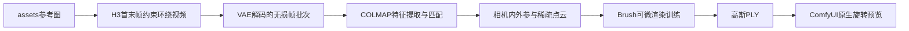

# 功能原理与完整流程

本功能把一张参考图变成可旋转观看的静态3D Gaussian Splatting场景。它由H3多视图生成、COLMAP相机与稀疏几何重建、Brush高斯训练、ComfyUI原生预览四部分组成。全部在本机运行。



## 1. H3如何把单图变成多视角

参考图只展示一个方向。H3补全侧面、背面和未见环境，产生假设的连续多视角画面。提示词约束人物、衣服、手持物和背景保持静止，只让镜头绕行；输入经同一次768×768裁切后同时连接first_frame和last_frame，帮助回到起点。

当前配置为FL2VA INT8、Qwen3-VL32B INT8、视频VAE、Orbit LoRA1.0，28步Euler/simple、CFG1、shift12/3、seed904231，141帧、24fps，约5.875秒。141满足H3的17k+5帧网格。

同图首末帧不保证中途几何正确。视频可以在观感连续的同时让包的位置、衣服结构、背景边缘缓慢变化。背面是模型推断，不能据此测量原物真实尺寸或结构。

## 2. 无损抽帧

COLMAP节点直接接VAEDecodeTiled输出的IMAGE批次，不从压缩MP4重新解码。每2帧取1张，去掉近重复的最后一帧，保存索引0、2、4…138，共70张PNG。MP4保留141帧，作为观看原始视频使用。

抽帧不会创造新的观察角度。更高帧数可能只是产生更多相似帧；运动模糊、对象变化和重复角度仍需检查。

## 3. COLMAP如何恢复三维关系

### 特征提取与匹配

COLMAP在每张图中检测SIFT特征与描述子，例如宇航服按钮、标志和背包纹理，再在不同图片之间建立二维对应。默认exhaustive匹配覆盖所有图片对，包含360°视频首尾附近的对应；sequential只按序列邻接关系匹配，适合作速度对照。

### 相机与点云

根据二维对应，COLMAP联合估计每张图的相机位置、朝向和三维特征点。相机参数分为：

| 参数 | 含义 | 当前设置 |
| --- | --- | --- |
| 内参 | 焦距、主点等成像参数 | SIMPLE_PINHOLE：f、cx、cy，70帧共享 |
| 外参 | 每帧相机的位置与朝向 | 根据匹配求解，每帧独立 |
| 三维点 | 被多张图共同观察到的特征点坐标 | 组成稀疏点云 |

SIMPLE_PINHOLE不拟合径向畸变，使用一个焦距。共享内参减少通过逐帧改变焦距吸收矛盾的自由度。默认global_mapping同时求解全局位姿；节点也提供incremental_mapping，便于在同一帧集上比较。

当前使用官方PyCOLMAP4.2.1的原生编译库；SIFT、匹配、全局定位与BA明确运行CPU，线程设置为12。global_mapping是已合入COLMAP的GLOMAP算法，不需要单独的glomap可执行文件。

SfM坐标的原点、朝向和尺度没有物理标定。相机全部注册只能说明求出了位姿，不能证明轨迹合理或场景真实。须结合重投影误差、点云、轨迹连续性和实际渲染检查。

## 4. Brush如何训练3D高斯

Brush读取images和sparse/0，以稀疏点云作为初始化，用带透明度的小椭球表示场景。每个高斯主要包含中心位置、三个方向的缩放、四元数旋转、不透明度以及球谐颜色系数。

训练循环是：选取已知相机位置 → 渲染当前高斯 → 与对应图片比较 → 更新参数，并按训练规则增密或裁剪高斯。它要让同一组3D高斯解释多个视角。

这里的5000步训练是当前场景的优化，不是重新训练或微调H3大模型。历史实测使用Brush0.3.0通过Vulkan运行于RTX5090D，分辨率768，最多500k高斯，SH degree3。500k是数量上限；实测宇航员30,652个、提灯18,187个。

训练前节点卸载ComfyUI推理模型，释放GPU显存。每8张图留出1张评估；70张时共9张留出图。它们没有参与3DGS训练，但参与了COLMAP位姿求解，且训练中仍有相邻生成帧，因此指标只表示对生成视频的插值还原能力。

## 5. 输出是什么，可以做什么

最终scene_5000.ply是高斯外观模型，可以在ComfyUI原生PreviewGaussianSplat中旋转、缩放和检查新视角，或交给兼容3DGS的软件查看。sparse_points.ply仅是稀疏点云，不能把它当作训练完成的模型。

适用范围是静态人物或场景的外观浏览、受监督视角附近的新视角渲染、3D展示试验。输出没有自动获得封闭网格、UV、骨骼或动作绑定；需要角色动画或精确商品结构时，还需后续建模和清理。

宇航员输入只有上半身，截断区域在新视角出现放射状漂浮高斯；提灯组的包和环境跨帧关系矛盾，出现明显拖影。完整执行成功与成品质量合格分开记录，见[本地测试报告](本地测试报告.md)。

## 6. 四套工作流的操作流程

| 工作流 | 开始位置 | 适用操作 |
| --- | --- | --- |
| 01_assets宇航员_环绕到3DGS | 一张assets参考图 | 完整生成、重建、训练、原生预览 |
| 02_assets提灯_环绕到3DGS | 提灯产品参考图 | 完整场景对照，保留质量失败样例 |
| 03_复用COLMAP数据集_仅训练3DGS | 已有dataset目录 | 调训练步数等参数，不重复H3和SfM |
| 04_原生高斯PLY预览_无需重新训练 | 已有PLY | 只加载和检查模型，不重复训练 |

从图片开始：打开01 → 在LoadImage更换图片 → 检查居中裁切是否截掉主体 → 保持同图连接首末帧 → 点击运行 → 查看轨迹、报告和原生PLY预览。

复用重建：打开03 → 输入包含images、sparse/0、report.json的容器内dataset路径 → 调步数、分辨率或高斯上限 → 点击运行。

只看模型：打开04 → 输入容器内PLY路径 → 点击运行 → 在预览区域滚轮放大、拖动旋转；默认相机较远时可打开大视图。新安装节点后刷新ComfyUI标签页，以重新获取节点定义。

## 7. 运行目录与排查

```text
output/h3_gaussian_splat/<项目名>/
├── orbit_*.mp4
├── first_*.png / last_*.png
└── dataset_*/
    ├── config.json
    ├── images/                   无损帧
    ├── database.db               特征与匹配
    ├── sparse/0/                 相机、位姿、稀疏点
    ├── sparse_points.ply
    ├── report.json / sfm.log
    └── brush_*/
        ├── scene_5000.ply
        ├── training_report.json / train.log
        └── eval_5000/
```

每次运行创建独立dataset和brush目录，保留旧结果。节点在注册相机不足8张时阻止训练；工作流取消时会终止启动的子进程。COLMAP在单独Python进程运行，避免原生库异常直接结束ComfyUI服务。

重建失败先看sfm.log和源视频；训练失败看train.log及Vulkan环境；PLY加载成功但效果差时看几何一致性、遮罩、视角覆盖及截断区域。安装位置见[Linux说明](Linux安装与路径说明.md)，后续改进顺序见[优化建议](优化建议.md)。

## 参考资料

- [原始Reddit教程](https://www.reddit.com/r/StableDiffusion/comments/1wi85by/for_anyone_wondering_how_i_manage_to_do_this/)
- [COLMAP教程](https://colmap.github.io/tutorial.html)
- [PyCOLMAP官方说明](https://colmap.github.io/pycolmap/index.html)
- [Brush项目](https://github.com/ArthurBrussee/brush)

原帖与本机实现的差异另见[技术分析](技术分析.md)。
