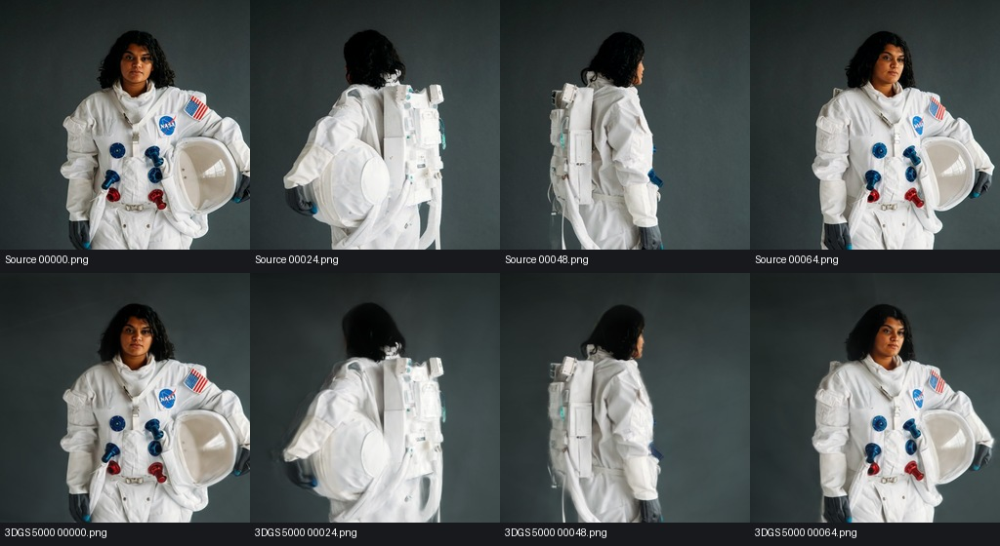
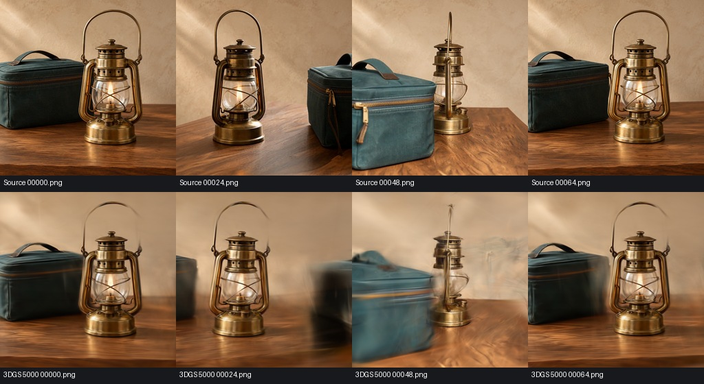

# 历史功能验证与质量限制

以下数据来自2026-10-16的功能原型实测，用于说明方法能力与局限，不是当前构建机器的性能承诺，也不代表任何设备驱动均可运行。两组均为768×768、141帧、24fps，70张无损抽帧，Brush5000步、SH degree3。

| 指标 | 宇航员 | 提灯场景 |
| --- | ---: | ---: |
| 注册相机 | 70/70 | 70/70 |
| 稀疏点 | 9,229 | 5,080 |
| 平均重投影误差 | 0.847px | 1.329px |
| 最终高斯 | 30,652 | 18,187 |
| 9个留出视角PSNR | 29.562dB | 19.299dB |
| 9个留出视角SSIM | 0.9137 | 0.7166 |

宇航员上半身外观较好，但新视角下截断区域出现放射状漂浮，背景雾状，需要清理。提灯的包、桌面和背景跨帧关系不一致，存在拖影与不连续轨迹，质量不合格。70/70注册和成功导出并不足以证明得到可交付模型。

留出图没有参与3DGS训练，但全部参与SfM求姿态，且训练集中还有相邻帧；这些指标不是独立实拍真值。下面上排为源帧，下排为高斯渲染。图中未覆盖所有极端新视角。

本镜像不附带整套历史运行日志、PLY和视频。完整功能原理见[流程说明](功能原理与完整流程.md)，待验证的改进见[优化建议](优化建议.md)。
