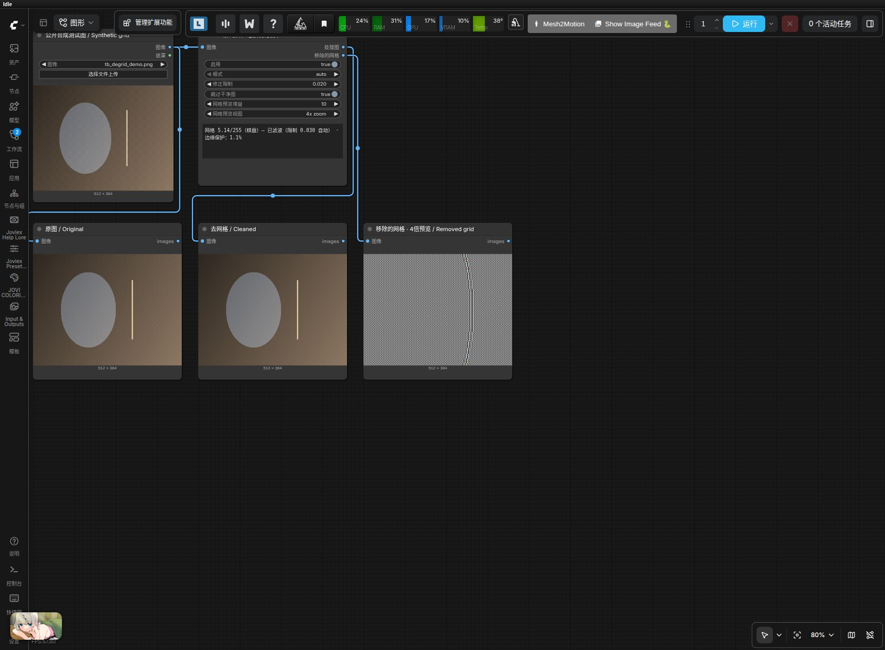

# VAE 去网格

`ToolBoxVAEDeGrid`（`tb-vae-degrid` / 中文 `tb-VAE去网格`）移除 Qwen Image、Qwen Image 2.1 和 Wan 2.1 VAE 原生解码中的低幅度 2px 网格，适用于使用这些 VAE 的 Krea2、Anima 等工作流。

连接顺序：`VAE Decode → ToolBoxVAEDeGrid → 锐化 / 放大 / 修复 / 保存`。放在任何缩放之前；经过缩放或修复的网格相位可能已改变，后置去网格无法撤销之前对伪影的放大。不要把它作为任意周期网格、摩尔纹或 JPEG 伪影的通用消除器。

无需新模型或额外依赖，只使用 ComfyUI 已有的 PyTorch。更新插件后重启 ComfyUI 并刷新页面，搜索 `degrid` 或 `去网格`。

## 参数与输出

| 输入 | 默认值 | 作用 |
| --- | --- | --- |
| `image` | IMAGE | 原生 VAE Decode 输出，标准 `[B,H,W,C]` 浮点图像 |
| `enabled` | true | 关闭时原图透传，网格预览为灰色 |
| `mode` | auto | 自动逐图校准；manual 使用 `limit` |
| `limit` | 0.02 | 仅手动模式：最大修正幅度，范围 0–0.10，步长 0.001；过高可能柔化细纹理 |
| `skip_when_clean` | true | 网格幅度小于 0.5/255 时原始像素透传；关闭可强制滤波 |
| `grid_gain` | 10 | 仅网格预览的放大增益，范围 1–50 |
| `grid_view` | 4x zoom | full frame / 4x zoom / 8x zoom；放大使用中心裁剪和最近邻采样 |

两个输出均为 IMAGE：`image` 是同尺寸、同 dtype、同设备的处理图；`removed_grid` 是修正成分乘以增益、加上 0.5 灰色并裁剪至 0–1 的诊断图。放大预览尺寸约为原图尺寸，不能将其作为处理图使用。干净图即使在混合批次内也保留原始像素，逐图检测及校准互不影响。

执行后的只读状态显示网格幅度、棋盘/竖条/横条主方向、滤波或透传、修正限制及保护比例。保护比例是修正超过限制的像素/通道占比，不是单独的边缘分割。批次只展示首图摘要并注明图片数量。状态内容不保存到工作流或传给执行参数。

该节点也是界面输出节点，加入工作流后即使没有下游预览也可执行并报告状态；命中执行缓存时恢复缓存的检测结果，不强制重算，也不保存成品文件。

网格只有 2px，完整画面缩略图看起来可能接近灰色；默认 4x 或 8x 放大更容易看清。若网格预览中出现明显人物、织物等真实细节，尝试手动模式并降低限制。手动限制为 0 时不会修正图像，状态仍可显示检测幅度。

## 对比示例

1. 将 [合成网格示例图](../examples/degrid/assets/tb_degrid_demo.png) 复制到 `ComfyUI/input/`。
2. 拖入 [原图、处理图与网格预览工作流](../examples/degrid/01-去网格对比.json)，运行后对比三路预览。该图是公开合成测试图，包含人为添加的棋盘与条纹，不是模型生成效果样本。
3. 在实际生成工作流中，将节点输入改接 VAE Decode。通过 `enabled` 比较前后，通过 `grid_view` 和 `grid_gain` 检查移除成分。

同目录的 [API JSON](../examples/degrid/01-去网格对比.api.json) 可用 `/prompt` 队列调用。示例使用 PreviewImage，不自动写入成品文件。运行 `python3 scripts/generate_degrid_example.py` 可重建公开合成图和示例。

[验收记录](testing/degrid_2026-10-12.md) 包含 CPU/CUDA 测试、13 个真实 API 队列任务及界面保存检查。

## 来源与许可范围

核心算法来自 [lunaaispace-eng/ComfyUI-DeGrid](https://github.com/lunaaispace-eng/ComfyUI-DeGrid)，固定提交 `8082f8b04e0b4a79220e493d5647a0c32e1ff855`。感谢原作者提供的纯 PyTorch 去网格算法。上游核心代码保持原样，ToolBox 提供节点适配、状态显示、本地化、示例及测试。

Apache-2.0 仅适用于此第三方 DeGrid 组件，完整许可保存在 [DeGrid 模块目录](../nodes/degrid/LICENSE)，不替换 ToolBox 整体及其他模块的许可。详见 [来源与适配说明](../nodes/degrid/UPSTREAM.md)。独立节点 ID 不与原插件的 `VAEDeGrid` 冲突，可同时安装；不会自动修改 VAE Decode 或已有工作流。
