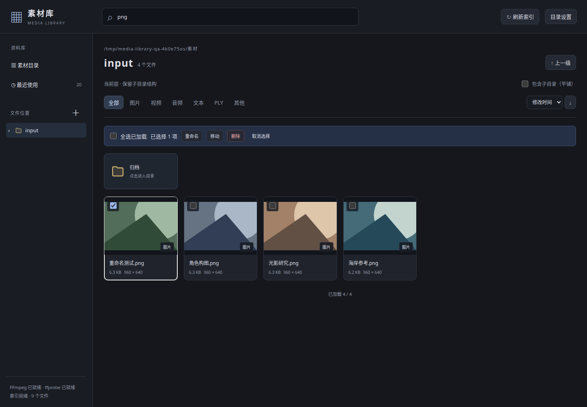
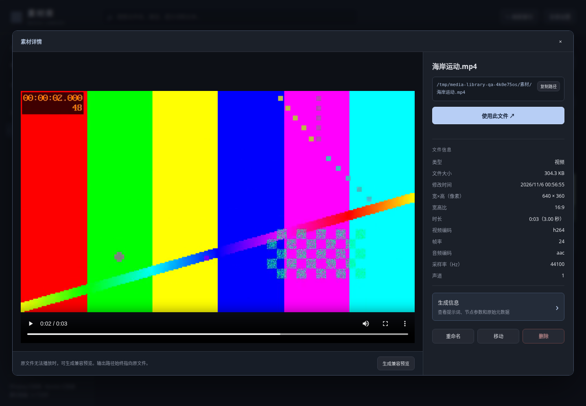

# tb-media-library · ToolBox 通用素材库

直接浏览、管理服务器磁盘上的文件，并将**原文件绝对路径**交给工作流。选择素材不会上传、复制或导入到 `input`。

点击卡片弹出详情：左侧大尺寸预览，右侧完整路径、文件信息、生成信息与操作。按 Esc、点击关闭按钮或弹窗外侧关闭；保留搜索、多选和列表滚动位置。

## 安装与入口

本功能内置于 ComfyUI-ToolBox。使用 ComfyUI 的 Python 安装 ToolBox 根目录的 `requirements.txt`，重启 ComfyUI 并刷新页面。搜索 `tb-media-library` 或 `ToolBoxMediaLibrary`，分类为 `ToolBox → Media`。

顶部“素材库”打开独立图库，浏览和关闭不创建节点；点击“使用此文件”才在当前画布或子图中心添加节点。节点内的浏览按钮只回填当前节点。只读画布会显示错误并保留图库。

需要 Python 3.10 及以上、Pillow 和 aiohttp。音视频信息和兼容预览使用 FFmpeg、ffprobe，图库左下角显示检测结果。仓库附带构建网页，普通安装无需 Node.js。

## 使用

- 点击节点上的“浏览素材库”，或者在 ComfyUI 地址后打开 `/toolbox/media-library/gallery`（例如 `http://127.0.0.1:8188/toolbox/media-library/gallery`）。网页随 ComfyUI 启动，共用端口。
- 节点已有素材时，打开图库直接进入该素材当前所在目录，展开左侧目录并定位、高亮文件；素材经插件移动或重命名后，按保存的 ID 定位最新路径。仅加载文件所在分页及当前层目录，不递归加载全库。
- 点击“上传素材”可多选本机文件，直接使用 ComfyUI 官方 `/upload/image` 接口，支持图片、视频、音频、文本及其他文件。默认保存到 `input/tb_media_library`；正在浏览 `input` 或其子目录时保存到当前目录。上传后定位到新文件，仍需点击“使用”才回填节点。沿用官方同名文件处理与上传大小限制，不覆盖已有文件。
- 复制图片后，选中素材库节点按 `Ctrl+V`（macOS 为 `⌘V`），或在节点预览区域中粘贴，自动上传到 `input/pasted` 并更新该节点的路径和预览，不运行工作流。图库网页中也可粘贴图片，上传后定位到文件，再点击“使用”。文字输入框保留正常粘贴行为。
- 默认浏览 ComfyUI 实际配置的 input、output、temp；通过“目录设置”添加其他服务器绝对目录。左侧箭头展开子目录；点击目录名称只显示当前层的子目录和文件。首页只显示配置的目录入口，不自动加载全库。开启“包含子目录（平铺）”才递归展示当前目录下所有文件；切换目录时自动关闭。
- 隐藏子目录不显示，也不会进入递归扫描与平铺。
- 搜索匹配当前浏览范围内的文件名、完整路径、已提取提示词、原始文本元数据以及文本文件内容，支持中文。默认仅当前层；主动开启“包含子目录”后才搜索后代文件。
- 点击文件卡片打开详情；多选模式下双击打开，勾选状态保留。点击“使用此文件”回填发起选择的节点。节点只有一个输出：`path: STRING`，连接到接受路径字符串的加载节点；不替换其他节点的选择器。
- 单独打开网页时，“使用”将文件加入最近使用并复制路径；从节点打开时，“使用”更新该节点，不启动工作流。
- **最近使用**最多保留 20 项，同一文件重复使用置顶且不重复计数。服务端保存，重启及更换浏览器后仍可查看。浏览详情或运行节点不会产生使用记录。
- 每次打开详情会检查文件是否变化。进入目录时按需扫描当前层，不在启动时递归扫描全库。新增、外部修改或移动文件后点击“刷新索引”，范围遵循当前目录及“包含子目录”开关；内部文件操作会立即更新索引。后台索引建立时可继续浏览已入库文件。

| 文件 | 详情展示 |
| --- | --- |
| 图片 | 缩略图、大图、旋转校正后的宽高、比例、帧数、生成信息及原始元数据 |
| 视频 | 播放/暂停/拖动进度、封面、时长、宽高、比例、帧率、编码、音轨及已有生成信息 |
| 音频 | 播放/暂停/拖动进度、时长、编码、采样率、声道 |
| 文本 | 只读内容预览和复制，支持 UTF-8、带 BOM 的 UTF-16 和 GB18030 |
| PLY | 只读头部、格式、顶点数、面数量；不渲染三维内容 |
| ZIP 及其他文件 | 名称、完整路径、类型、大小、时间；不解压、不读取内部内容 |

浏览器不能解码的音视频会尝试生成兼容预览，也可手动点击生成按钮。视频兼容预览为最多 1280×720 的 H.264/AAC MP4；音频为 AAC。**节点始终返回原文件路径，不返回预览缓存路径**。依赖缺失、转换失败、读取失败会显示原因。

生成信息从 ComfyUI prompt/workflow、A1111/Forge 参数及常见媒体标签中提取。点击“生成信息”打开独立弹窗，左列标题、右列数据，仅显示提示词、模型、LoRA、种子、步数、CFG、采样器、调度器和降噪强度等关键字段。支持单项复制；“复制所有信息”仍复制完整信息和原始元数据 JSON，关键信息弹窗保持简洁；“查看所有信息”另开 JSON 树弹窗。原文件和内嵌元数据始终只读。

## 文件管理

勾选卡片后，可批量重命名、移动、永久删除；详情中也提供单文件操作。

- 点击“多选”后，可点选卡片、勾选或全选当前页。右键已选素材可删除全部已选项；右键未选素材只操作该项。
- 重命名支持 `{name}`（原名称去掉末尾扩展名）、`{index}` 或 `{index:03d}`，自动保留原扩展名，可设置起始序号。
- 重命名可预览新旧名称后执行；移动直接选择目标目录并执行。存在同名文件时拒绝覆盖，执行前会复查源文件状态。
- **删除为永久删除**：点击删除直接列出原文件及关联附件，一次点击“永久删除”确认；没有额外的预览按钮或勾选框。
- 移动弹出当前目录的文件夹列表，点击文件夹进入、点击 `..` 返回上一级，到配置目录边界时返回素材目录入口。点击“移动到这里”直接执行。跨盘移动完成复制、SHA256 校验和源文件状态复查后才删除源文件；失败时保留原文件，并逐项报告结果。
- 明确归属于原文件的 `文件名.扩展名.xmp`、`文件名.扩展名.json` 作为元数据附件；同名主文件只有一个时也识别 `文件名.xmp`。它们列入操作清单。普通同名 `.txt`、归属不明的侧车文件不自动操作。
- 插件内重命名、移动保留素材 ID；已经保存的节点在下次运行/加载时解析新路径。外部移动或删除使原记录失效，不会静默换用另一文件；最近使用可清除失效项。
- 移除一个自定义目录只移除访问与索引范围，保留磁盘文件。符号链接不自动跟随；需要浏览链接目标时，将目标目录单独加入素材库。

工作流的可见路径可手动修改；修改时清除之前的 ID 关联。工作流复制到另一台服务器时，需要重新选择当地文件。

## 数据与接口

数据位于 ComfyUI 实际 `user` 目录下的 `tb_media_library/`：

- `catalog.sqlite3`：目录配置、素材 ID、文件索引、提取元数据、最近使用。运行中备份时应包含 WAL/SHM 或使用 SQLite backup；停止 ComfyUI 后可直接复制整个目录。
- `cache/`：可重建的封面和兼容预览；按七天/2 GiB 清理，正在生成的最新预览暂时保留。

重装或升级插件代码不覆盖这些数据。索引仅服务配置目录；数据库与缓存本身不作为素材显示。

接口统一位于 `/toolbox/media-library/`。详见 [接口说明](api.md)。完整源码与第三方读取器分开存放；第三方原始许可和固定提交记录位于 `vendor/`，参见 [NOTICE](NOTICE.md)。

## 开发与验证

见 [开发说明](development.md)。浏览器和文件管理测试仅使用临时生成素材。

[示例工作流](../../examples/media_library/media_library_path.json) 包含新路径节点；将其 STRING 输出连接至已有的路径加载节点。

## 来源

由本地 `comfyui-media-library` 项目整合，原项目源码保留。原始许可和第三方说明位于 `nodes/media_library/LICENSE`、`nodes/media_library/NOTICE.md`。
