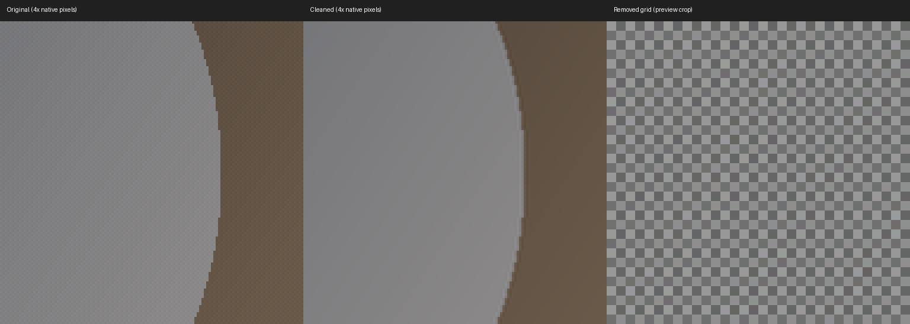
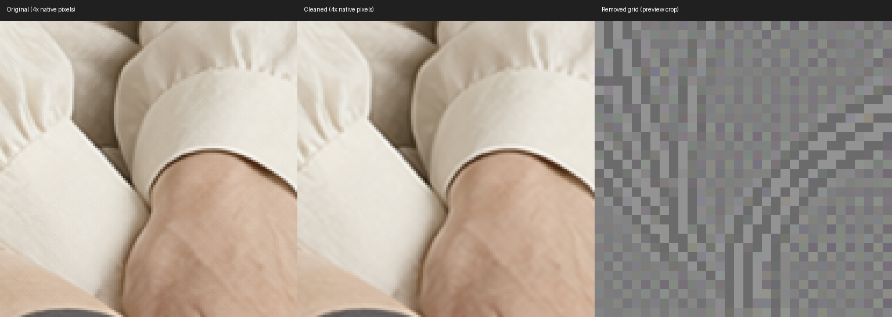

# 2026-10-12 DeGrid 接入验收

上游固定提交：`8082f8b04e0b4a79220e493d5647a0c32e1ff855`。
移植核心与上游逐字节一致，SHA256 为
`cee414b123ae19e7bc6770757818389ad6ededd7830c30065dd68477e1cc40ca`。
ToolBox 适配使用独立 `ToolBoxVAEDeGrid` ID；Apache-2.0 许可保存在 DeGrid 模块内。

## 数值与前端测试

在测试容器的 Python 3.13 / PyTorch 2.11.0+cu130 环境执行：

```bash
python3.13 -m pytest --confcutdir=tests tests/test_degrid.py -q
node --test tests/*.test.mjs
```

44 项 DeGrid Python 测试通过，覆盖 CPU/CUDA、棋盘/横条/竖条去除、常量和线性渐变、float16/float32 小图及奇数尺寸、float64 精确透传、混合批次逐图校准、手动限制与零限制、干净高频内容跳过和强制执行。预览视图和增益不改变处理结果；输入 tensor 不被修改。

全部 40 项前端测试通过，其中 4 项新增测试验证只读状态、中英文检测/旁路/强制执行/批次摘要、生命周期回调保留、序列化排除状态和对其他节点无影响。另检查当前仓库完整插件入口能够注册新增节点，并保留已有节点。

## 真实 ComfyUI 队列

测试实例：`comfyui-test-cu130-megapak-pt211`，ComfyUI 0.39.0、前端 1.53.10、RTX 5090 D。
仅向该实例部署新增 DeGrid 模块、前端和注册/本地化条目，保留其已有模块。

通过实际 `/prompt` 队列运行 1 张公开合成网格图和 12 张已有原生 Qwen 2.1 2048×2048 图片。API 工作流的原图、处理图和网格预览均由 PreviewImage 输出；所有 13 个任务 success。未加载或下载新模型，未重新生成高清素材。

另重复提交最后一张高清图，任务 `473a2325-7c64-4fac-881c-b1d29b4af6b9` 命中 DeGrid 执行缓存且 success，检测状态与首次执行完全一致。DeGrid 标记为界面输出节点，保证下游同样命中缓存时仍可回放状态，不强制重新滤波。

| 检查 | 结果 |
| --- | --- |
| 三路预览、节点结构化状态 | 13 个任务均正常 |
| 12 张原生高清图尺寸 | 全部保持 2048×2048 |
| 原生高清图检测幅度 | 0.830–1.296/255 |
| 处理图 PNG 再测网格幅度 | 0.115–0.160/255；下降 81.5%–90.2% |
| 原生高清图平均逐通道像素变化 | 0.565–0.635 灰阶；PNG 最大变化 2–3 灰阶 |
| 原生高清图修正触及限制的比例 | 0.605%–2.535% |
| 13 个处理预览与本地计算转为 PNG 的对比 | 最大误差均为 0 灰阶 |
| 合成图网格幅度 | 5.139/255 → 0.159/255 |

逐图检测数据、参数和任务 ID 见 [机器可读报告](degrid_2026-10-12.json)。上述输出测量来自 8-bit PNG，含保存量化；精确透传保证在浮点 tensor 层测试。去网格并不保证任意真实纹理完全不变。





高清对比为第 12 张素材的中心 128×128 裁剪，以最近邻放大到 512×512。观察到细网格减弱，袖口轮廓及皮肤细节仍可辨认；它只是固定样本的局部视觉检查，不是对所有纹理的质量保证。第三栏是节点网格预览的中心裁剪，已包含节点自身 4x 放大。

## 界面与保存

从工作流列表 `ToolBox/DeGrid/01-去网格对比` 打开公开示例，界面执行任务 `e92ffda3-bbd3-4368-94b9-b082ff91738f` success。中文状态显示网格 5.14/255、棋盘、自动限制 0.030、边缘保护 1.1%；状态 textarea 为只读。

Ctrl+S 保存后从磁盘检查节点 `widgets_values`：

```json
[true, "auto", 0.02, true, 10, "4x zoom"]
```

状态文本及占位值没有进入参数；重新加载保留输入和六个控件参数。重载后再次执行任务 `8b336106-076c-46d9-92c9-394b099819b9` success，全部五个节点命中缓存，仍恢复检测状态。节点 ID 不包含上游 `VAEDeGrid` 别名。


复跑 API 验证：先将公开合成图放入 ComfyUI/input，再在具有 ComfyUI Python 依赖的环境运行 `python3.13 scripts/test_degrid_api.py`；可重复传入 `--image` 指定已有高清输入。默认报告和对比图输出到忽略的 `data/degrid_validation/`，示例不会写入成品文件。
