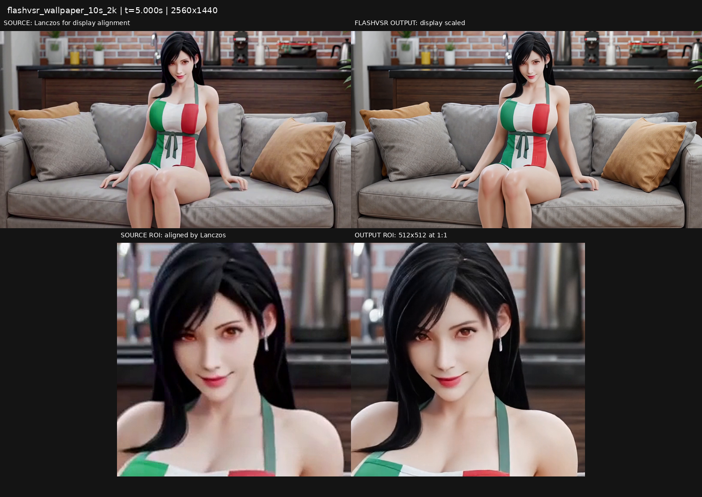
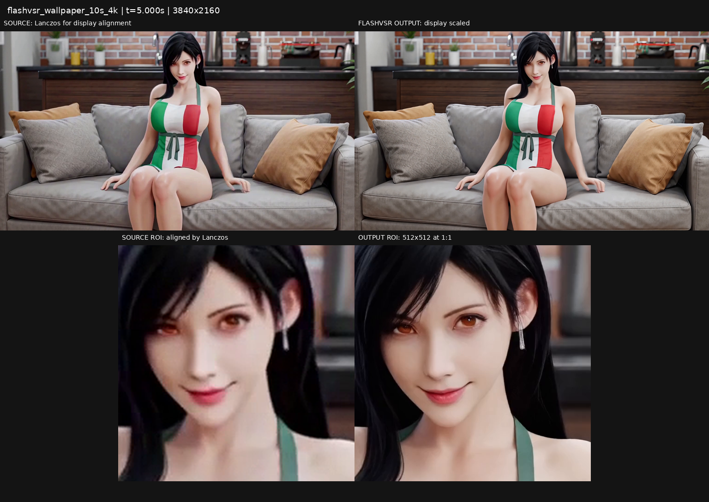
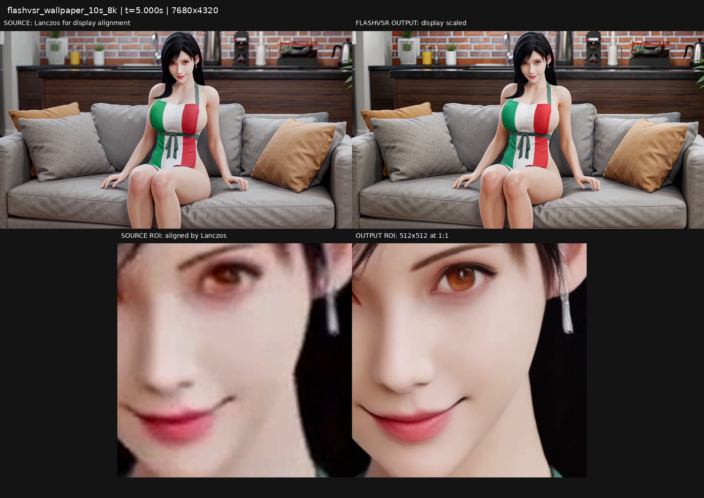
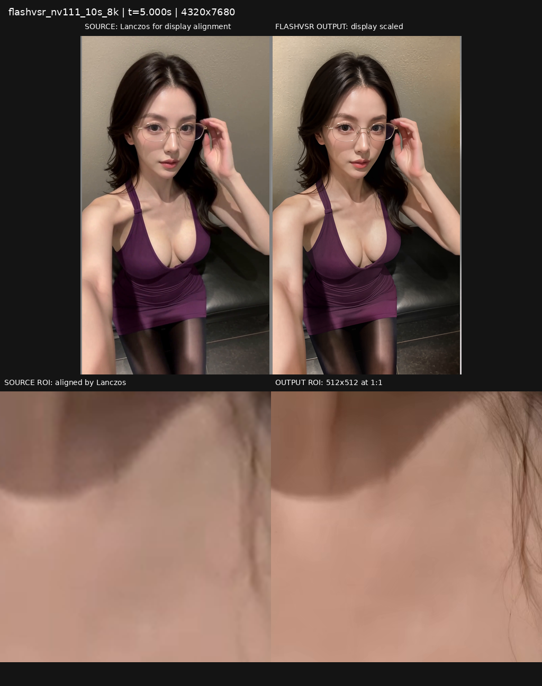
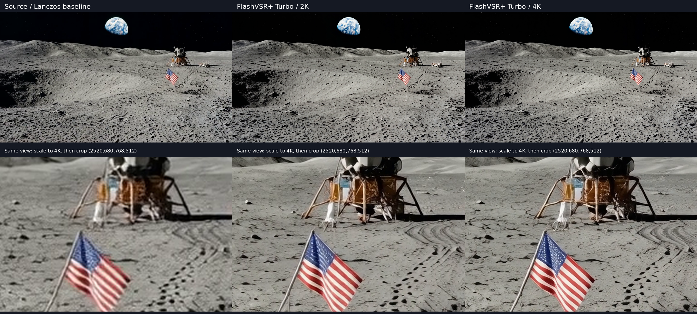

# FlashVSR 历史实测与迁移验证（2026-10-19）

## 已有历史记录

以下是迁移前真实记录，**不是新ToolBox实现的完整性能复测**。机器为RTX5090D 32GB、约94GiB主机RAM、Python3.13.12、Torch2.11/cu130、Triton3.6、驱动595.58.03。仅记录成功处理流程耗时，失败的整幅8K/OOM尝试不并入成功耗时。

| 素材 / 输出 | 时长s | 帧数 / fps | 流程耗时s | 端到端s | 进程 / 整卡显存GiB | 进程树RSS GiB |
|---|---:|---:|---:|---:|---:|---:|
| 壁纸系列1.mp4 / 2560×1440 | 10.0000 | 240 / 24 | 117.223 | — | 15.59 / 18.59 | 56.76 |
| 壁纸系列1.mp4 / 3840×2160 | 10.0000 | 240 / 24 | 258.662 | — | 28.06 / 31.06 | 58.15 |
| 壁纸系列1.mp4 / 7680×4320 | 10.0000 | 240 / 24 | 1445.226 | — | 22.68 / 25.68 | 48.43 |
| nv111.mp4 / 4320×7680 | 10.0000 | 240 / 24 | 1372.213 | 1382.980 | 24.61 / 27.52 | 60.43 |
| 动作参考.mp4 / 2160×3840 | 18.2167 | 1093 / 60 | 1268.044 | 1291.005 | 19.67 / 22.51 | 37.16 |

前三项同为壁纸10秒：2K整段、4K两个5秒段、8K两个5秒段×六块/FFV1；最后两项为不同素材/画幅的常驻流式优化。不同素材、画幅、codec和分块方式不能直接计算加速比。流程耗时通常排除临时服务启动，端到端仅在原始记录有此数据时列出，不补推。

| 15秒目标 | 状态 |
|---|---|
| 2K | 未测试 |
| 4K | 未测试 |
| 8K | 未测试 |

### 5秒补充记录

| 素材 / 输出 | 时长s | 帧数 / fps | 流程耗时s | 端到端s | 进程 / 整卡显存GiB | 进程树RSS GiB |
|---|---:|---:|---:|---:|---:|---:|---:|
| clean_00005_.mp4 / 2560×1440 | 5.0000 | 120 / 24 | 62.580 | — | 15.49 / 18.26 | 28.94 |
| clean_00005_.mp4 / 3840×2160 | 5.0000 | 120 / 24 | 126.988 | — | 28.06 / 30.82 | 55.47 |

峰值来自0.1秒采样。旧记录为隔离ComfyUI与子进程，RSS可能重复计共享映射，整卡显存包含桌面/其他进程。完整参数、来源SHA256、编码与计时口径见[结构化历史数据](flashvsr_history_2026-10-19.json)。仓库不保存源视频、输出视频、模型或运行缓存，也不把新增纹理当作真实细节。

## 原片与输出截图

每项使用同一中间时间点，历史横屏裁切/竖屏补边按记录对齐。上排全景仅为显示缩放；下排输出为512×512的1:1细节，原片对应区域经Lanczos对齐，非真实4K/8K参考。截图取自实际视频，没有AI重绘。

### flashvsr_wallpaper_10s_2k

### flashvsr_wallpaper_10s_4k

### flashvsr_wallpaper_10s_8k

### flashvsr_nv111_10s_8k

### flashvsr_action_18s_4k

### 早期5秒记录

## 本次迁移验证

迁移验证采用短片，不补跑完整10/15秒矩阵。结果见 [迁移验证](flashvsr_migration_2026-10-19.json)。

### 本次验证结果

- **24项编排测试通过**：实际VIDEO/FFmpeg、合成推理适配器；覆盖缓存像素一致、非整除/多重重叠、尾段与音轨、保留/清理/失效、取消、预算、磁盘不足、旋转拒绝和目录所有权，最终文件通过额度检查后才原子发布。
- **72项既有回归通过**：DeGrid、3DGS、提示词写入、肤色管线及现有FLUX2Klein修改保持可用。
- **14个实机接口场景通过**：真实ComfyUI与本机Turbo模型，含未选缓存的预期拒绝、三种缓存模式、CPU H.264/HEVC、NVENC、重编码与清理后重算、标准SaveVideo、2K/4K/8K短片、60fps和尾段。三个模式的编码前RGB SHA256完全一致。
- **完整源码57个节点可导入**，新增三个schema可读取，注册时未导入可选的FlashVSR推理插件。容器原有ToolBox版本较旧，增量保留原11个节点、加入3个新节点（共14），没有整体覆盖其他模块。
- 本地正式01–07已更新为显式连线，缓存均默认“请选择”；旧单节点ID不再注册，启动恢复不再恢复旧插件。原图/旧说明在仓库外备份，工作流目录仅保留7份可执行JSON。

| 实机短片场景 | 帧数 / fps | 输出尺寸 | API耗时s | 本次进程显存GiB | 本次进程树RSS GiB |
|---|---:|---|---:|---:|---:|
| real_model_raw | 3 / 24/1 | 512×384 | 14.00 | 4.69 | 14.11 |
| real_model_lossless | 3 / 24/1 | 512×384 | 13.10 | 4.56 | 14.94 |
| real_model_stream | 3 / 24/1 | 512×384 | 12.89 | 4.66 | 14.04 |
| cached_cpu_hevc_reencode | 3 / 24/1 | 512×384 | 1.44 | 0.88 | 8.48 |
| cleared_cache_recomputes | 3 / 24/1 | 512×384 | 13.00 | 4.69 | 14.71 |
| standard_SaveVideo_connection | 3 / 24/1 | 512×384 | 12.78 | — | — |
| 2k_nvenc_balanced | 3 / 24/1 | 2560×1440 | 17.07 | 9.63 | 15.50 |
| 4k_low_memory | 3 / 24/1 | 2160×3840 | 36.79 | 6.54 | 13.99 |
| 8k_tested_geometry | 2 / 24/1 | 4320×7680 | 58.21 | 19.13 | 14.45 |
| native_60fps_tail | 5 / 60/1 | 512×384 | 14.81 | 5.16 | 13.89 |
| final_stream_preflight_metadata | 3 / 24/1 | 512×384 | 13.88 | 4.66 | 13.17 |
| final_owned_raw_cleanup | 3 / 24/1 | 512×384 | 13.13 | 4.69 | 14.96 |
| final_atomic_publish_guard | 3 / 24/1 | 512×384 | 13.85 | 4.56 | 13.61 |

该表为短片功能验证，包含实际模型加载及API轮询，不能推算长片耗时。新记录在主ComfyUI进程中执行，与历史隔离进程计量口径不同；完整细节与Torch分配器/整卡峰值见JSON。缓存重编码的本次峰值仅列编码阶段，原缓存生成数据另存字段，不相加伪造当前耗时。标准SaveVideo不返回JSON统计，相关峰值留空。

内存/磁盘不足检查包含模拟场景，本次实际机器仍为94GiB RAM / 32GB GPU，不能描述为16/32GiB主机已经通过。测试媒体均在仓库外并清理；既有历史原视频/产物没有被当作迁移代码删除。
