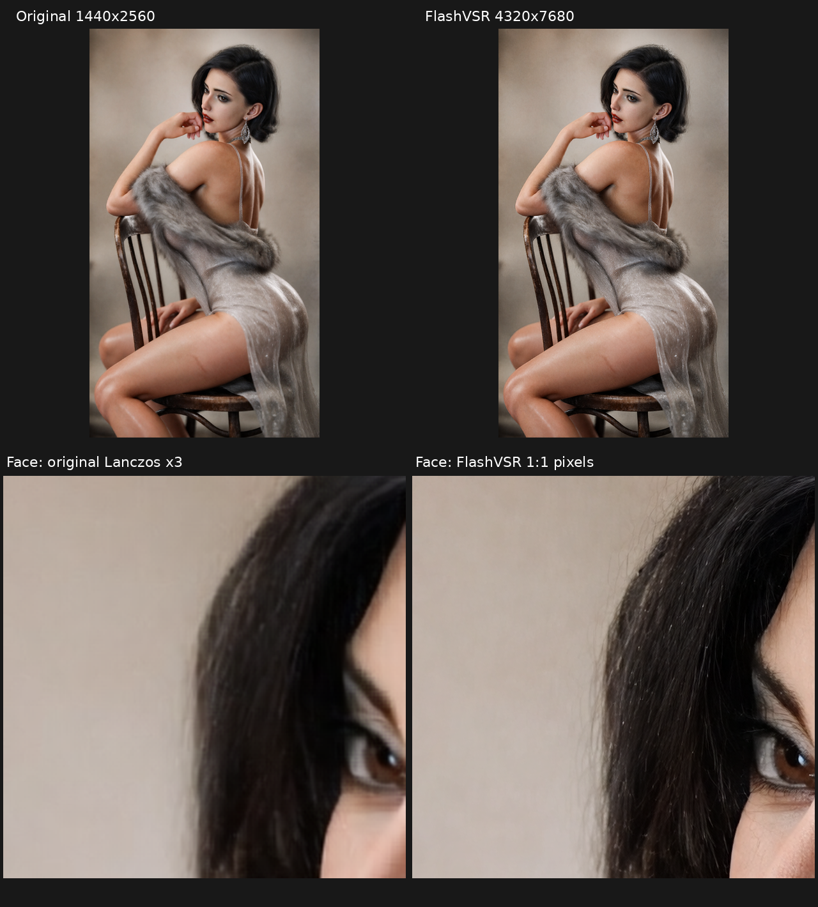
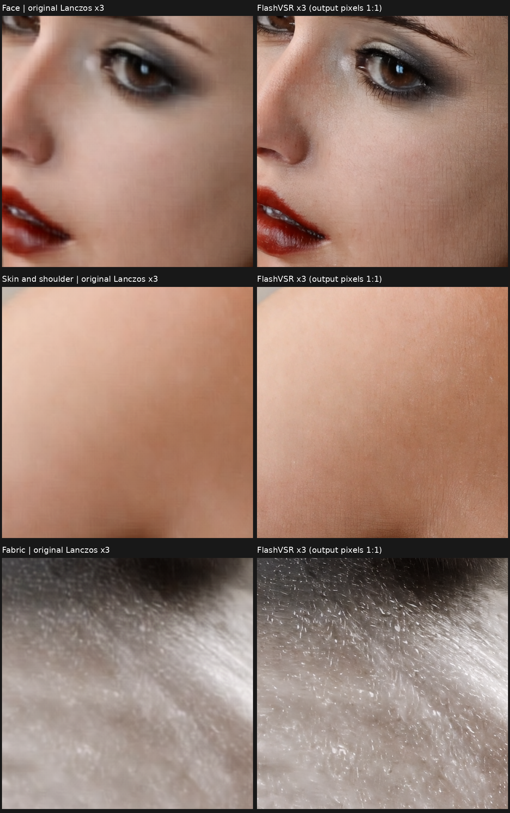
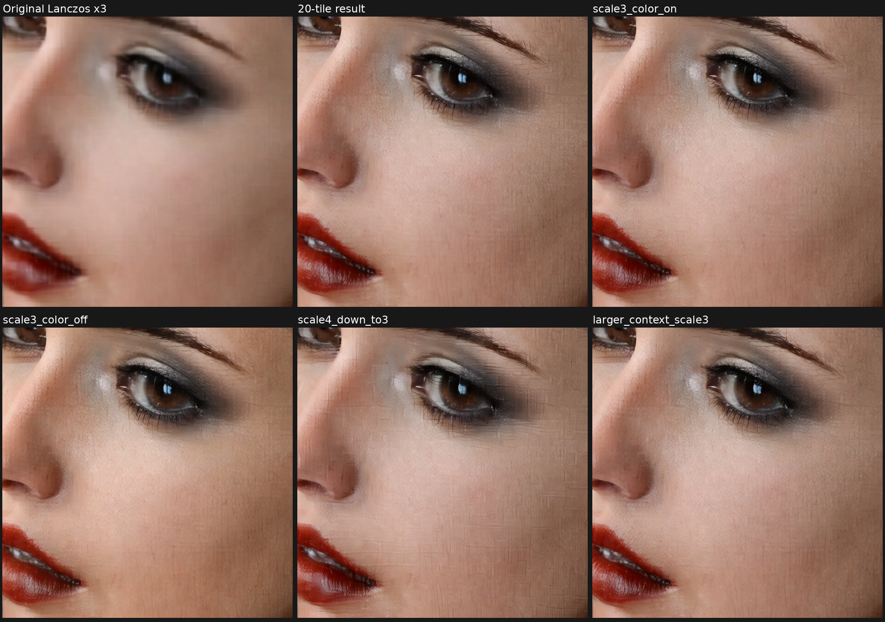
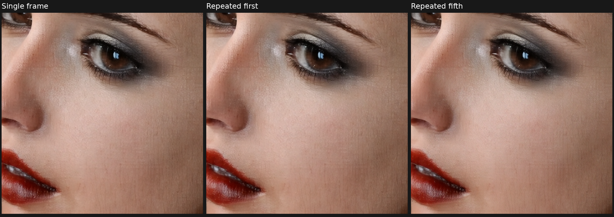

# FlashVSR 图像8K试验与画质诊断 · 2026-10-19

结论：**4320×7680 PNG生成成功，当前参考图的画质未验收通过**。使用者反馈效果差；实际局部对照可见皮肤颗粒/细网纹、布料短线纹理明显增强。这些新增细节不能认定为真实恢复。该结论限于本次 FlashVSR+ Turbo＋TCDecoder、种子和素材，不推广到全部FlashVSR权重。

## 素材、接口与实测

- 素材标识：`b2139c3af8040e0c69ba6a4f279b5882.png`，SHA256 `f5ac4d4cf4e32b91b3400acbb5fcc4ec38f101c5fda549f3805d4b97f6f5fb98`。
- 原图1440×2560 RGB，输出4320×7680 RGB、单张8-bit PNG；3倍线性尺寸、9倍像素。图片无fps/音轨/时长。
- 原生链路：LoadImage → 内置SplitImageToTileList → 上游KSampler/Decoder → 内置ImageMergeTileList → SaveImage，共享模型/解码器加载节点。**不使用ToolBox视频三节点，不转成视频**。
- 原图块512×640，重叠128，4列×5行=20块；各块独立单图推理，scale=3，输出块1536×1920，合并重叠384。原图未缩小，主体未裁切。块输出128对齐，不触发上游中心裁剪。
- FlashVSR+ Turbo，TCDecoder_plus，BF16，temporal=4，triton_block_sparse，seed=20261019，offload=false，wavelet颜色校正开启。上游Plus忽略steps/cfg/kv_ratio/local_range/sparse_ratio；Decoder.full_tiled不实现Plus空间分块。

| 口径 | 本次结果 |
|---|---:|
| ComfyUI执行事件耗时，含本次节点模型加载 | 89.208秒 |
| 提交到收到完成历史的客户端耗时 | 89.602秒 |
| ComfyUI进程树RSS采样峰值 | 10.165 GiB |
| 对应宿主PID的进程显存采样峰值 | 10.908 GiB |
| 整卡显存采样峰值，含桌面及其他进程 | 12.669 GiB |

约0.5秒采样，调用nvidia-smi带来额外间隔；采样峰值不代表捕获所有瞬时峰值。RSS包含共享映射。此为本机一张图片的试验，非其他硬件认证、非10/15秒视频性能矩阵；权重文件系统缓存状态未控制。环境沿用视频验证：RTX5090D 32GB、主机94.16GiB、Python3.13.12、Torch2.11+cu130、Triton3.6、驱动595.58.03。来源固定版本见[provenance](../../nodes/flashvsr/provenance.json)。TCDecoder加载报告66/66匹配，无missing/unexpected。

## 画质证据

同一原图坐标、同一视野。全景缩至360×640使用Lanczos；局部左侧原图Lanczos放大3倍，右侧模型输出按1:1像素展示。浏览器可能继续缩放整张截图，需打开图片查看原始尺寸。

## 控制变量诊断

面部原图ROI为(720,390)–(930,600)。局部推理采用原图512×640区域(640,256)–(1152,896)，大上下文采用768×896区域(480,128)–(1248,1024)。所有输出裁回相同ROI；不对齐或挑选不同位置来比较。诊断只用本机已有模型，不自动换模型或下载权重。

| 对照 | 观察与限度 |
|---|---|
| 完整20块结果 vs 单独一个ROI推理 | 单独推理仍出现类似颗粒；空间块合并不是该区域过强纹理的必要条件，但不能据此保证全图无接缝 |
| wavelet开启 vs 关闭 | 关闭后肤色偏差更大，细网纹仍在；低频颜色校正不能消除模型生成的高频纹理 |
| 3倍 vs 4倍推理后Lanczos缩回3倍 | 后者相对原图低分辨率颜色/结构偏差下降，但仍有网纹；不能把它判为全面改善 |
| 增大到768×896上下文 | 皮肤纹理仍明显，未观察到解决性改善 |
| 单图 vs 同图重复5帧的第一/第五帧 | 第一帧与原单图输出逐像素相同；第五帧仍有颗粒，未观察到解决性改善 |

局部高频强度（灰度减Gaussian sigma=1.2的RMS，8-bit数值单位）：原图Lanczos3倍约0.35，完整20块结果约3.37。该数值说明新高频大幅增加，**不是感知质量或真实细节恢复评分**；没有真实8K参考图，不能用PSNR/SSIM宣称更高质量。详细诊断参数及辅助数值见[JSON](flashvsr_image_2026-10-19.json)。

## 工作流界面错误与修复

最初UI序列化漏写seed后的“生成后控制”widget。ComfyUI自动插入该widget，导致后续值错位，界面scale回到4，而合成仍按3倍。**旧版UI图运行会出错位风险**。生成器现已补入`fixed`，确认界面width=512、height=640、scale=3、合成4320×7680/overlap384。LoadImage使用input根目录文件，避免下拉媒体检查遗漏子目录。

本次89.208秒的PNG来自API，实际执行scale=3；日志20块均为1536×1920，因此上述UI缺陷不能解释该PNG的所有画质问题。API流程正确不等于UI工作流正确，也不等于画质验收通过。

## 后续由使用者选择

1. **忠实保留原图**：Lanczos/Bicubic到8K，不添加生成纹理，清晰度提升有限。
2. **保留原图风格并少量增强**：原图插值结果与FlashVSR结果混合，让使用者选择增强比例；尚未选择或设为推荐默认值。
3. **继续纯FlashVSR**：保留当前试验图，另测其他兼容权重/解码器；不保证改善，不能将现有Turbo权重直接改名冒充Base。
4. **改用图像专用超分模型**：先用同一ROI比较，再决定是否跑完整8K；模型、强度、下载均未自动变更。

08示例供可复现试验与参数调整，不标为画质推荐。仓库只收录统计、工作流与对比截图；原图、8K完整输出和诊断临时图片保留在本机仓库外。
