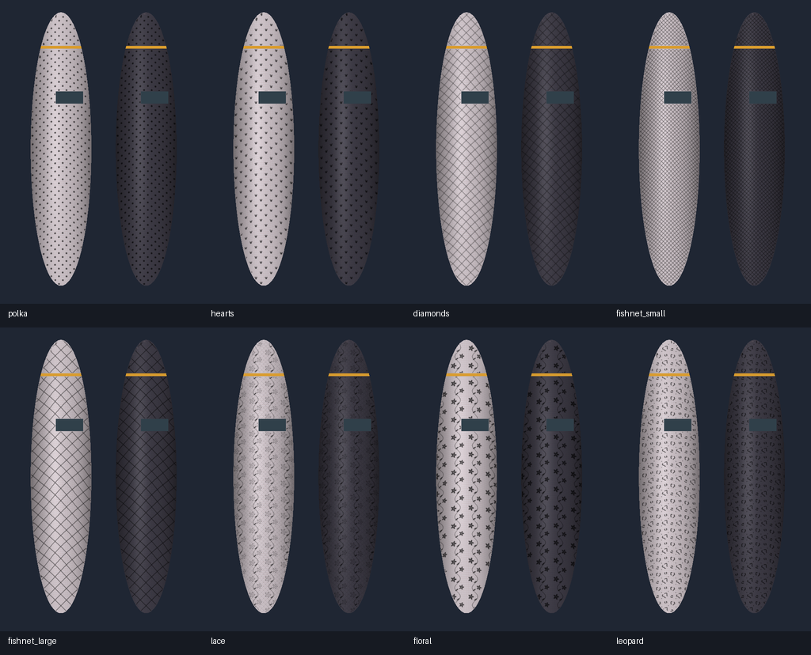

# 花纹、英文印花与钩丝验收 · 2026-10-10

测试容器：`comfyui-test-cu130-megapak-pt211`。当前代码已部署并重启；节点、前端、字体和语言文件共 36 个部署文件的 SHA-256 与工作区完全一致。模型、数据库及原有五份用户工作流未替换。

## 功能与兼容

- 样式注册表共 13 项：保留原五样式，新增波点、爱心、菱格、小渔网、大渔网、蕾丝、花卉和豹纹。
- 新花纹支持织物/印花模式，尺寸、旋转、颜色与不透明度独立。英文重复印花支持 BALENCIAGA、PARIS 和自定义可打印 ASCII 文本，保留大小写；左右腿文字不镜像。
- 钩丝、梯状抽丝支持随机、手工和混合，随机布局使用图片身份与种子，手工路径限定所属部位并按图片指纹保存。
- `effects_json` 为末尾可选输入，旧输入顺序和输出端口不变。`damage_strokes` 缺省为空，修改损伤不重算几何。
- 新效果置于独立渲染模块，上游 `core/` 文件未修改。关闭新增效果时，原五样式逐像素等于原核心输出。
- 修复旧工作流把状态文字落入新可选输入的问题；识别旧摘要并恢复空效果配置。导出仅保留实际输入控件，最终实际保存工作流含 21 个输入值，末尾为效果 JSON，没有状态/按钮值。
- 新前端入口为 `stocking_texture_effects.js`；部署脚本将旧入口归档为 `.legacy`，ComfyUI 仅发现一个入口，避免新旧扩展一起注册。

## 自动与实际队列

- 后端及工作流检查 **97 项通过**，另有 5 个子测试通过。涵盖八种花纹、两种表现、文字参数及朝向、损伤模式、种子、长路径、几何缓存复用、空图、批次过滤、精确裁剪、遮罩外原始浮点像素、透明图层和缓存限额。
- 前端 **27 项通过**：原有编辑/点选/坐标用例，新增文本验证、旧摘要迁移、13 样式中英文标签、图片绑定的损伤草稿保存和取消。
- PromptWriter **8 项回归通过**。总计 **132 项测试通过**，没有跳过；pytest 使用 `--confcutdir=tests` 隔离 ComfyUI 插件根目录导入。
- 四份新增公开工作流全部通过真实 ComfyUI 队列：06 八种花纹总览、07 英文印花、08 钩丝与抽丝、09 组合效果。合成图两部位的混合损伤示例报告 14 条损伤。所有新效果的 320×500 裁剪预览逐像素等于对应队列区域。
- 组合效果透明图层重合成逐像素等于成品，RGBA 的 alpha 包含 0 和 255。旧高级 Editor→Solve→Render 节点也完成蕾丝＋英文＋随机损伤，裁剪预览与成品一致。
- 原有 SAM3、深度两图批处理、五样式比较和图层/诊断四份推荐流程重新执行成功。

## 浏览器实际操作

在新入口页面打开公开组合示例，确认 13 项样式和四组控件出现。

1. 输入 `My Brand 2026!`，即时更新草稿；取消后重开恢复 PARIS，没有写入节点。
2. 选择 BALENCIAGA 和梯状抽丝，在左腿拖画一条路径，撤销、重做后保存。
3. 实际保存文件仅左腿增加路径，部位路径数为 `[3, 2]`，最后路径类型为 `ladder`；右腿未改变。
4. 保存工作流并执行，队列成功，报告 15 条损伤。刷新重开恢复 BALENCIAGA、花纹参数和手工路径；100% 细节预览正常。
5. 删除最后损伤、撤销恢复，再保存，文件中路径数仍为 `[3, 2]`。

公开示例的选区为 41.33%，组合效果实际变化约 38.49%。热预览约 22–23ms；首次文字/损伤配置的预览约 246–249ms，数字只适用于该 512×768 合成图及当前机器。

浏览器验收变体另存到容器 `_tests/stocking-effects-ui-2026-10-10.json`；`ToolBox/StockingEffects/` 的四份示例保持项目公开版本。测试草稿、备份、API 报告及浏览器截图保存在忽略的 `data/stocking_effects_validation/` 下。

## 图像与边界

所有新增示例及以下对比图使用项目公开合成图片，不包含用户照片。英文使用随项目分发的 DejaVu Sans Bold，其许可位于字体目录。当前效果不生成新的裸肤底图，不提供明显破洞、自定义贴图或字体上传。

