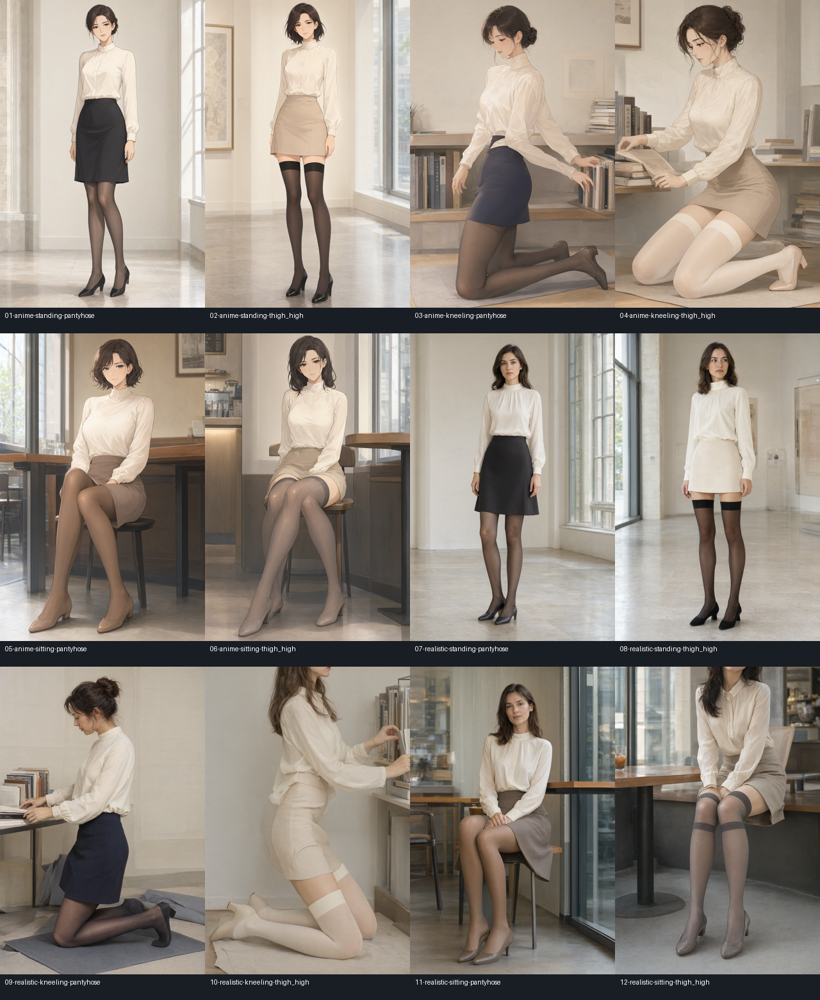
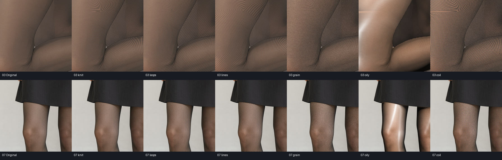
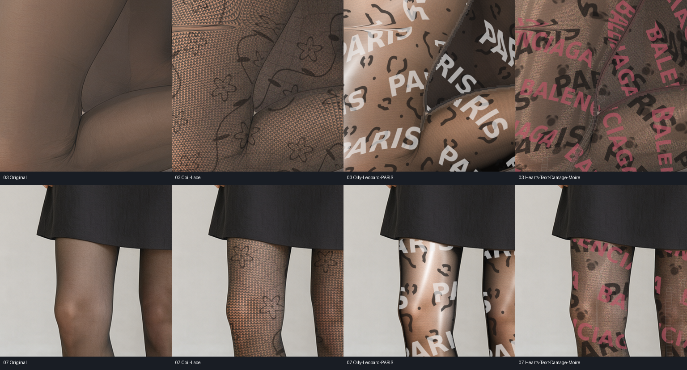
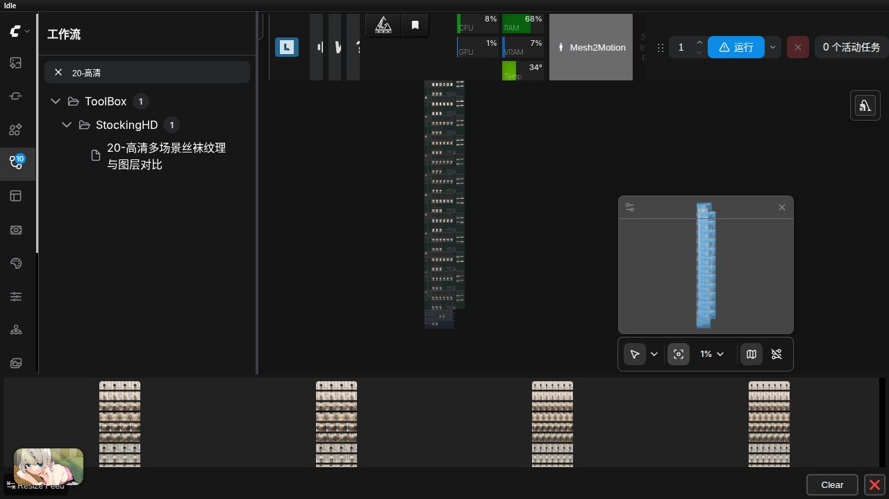

# 2026-10-11 原生高清多场景丝袜测试

使用已有本地 `qwen2.1 t2i 人物` 工作流的生成子图，复用 BF16 UNET、Qwen3-VL 8B 编码器、Qwen 2.1 VAE、Euler/simple、25 步、CFG 1。模型路径均为本地已安装模型，没有下载或调用远端生图服务。

## 素材

12 张原生 2048×3072（每张 6,291,456 像素）：二次元/写实 × 站姿/跪姿/坐姿 × 连裤袜/大腿袜。包含黑色、深蓝、灰色、褐色和浅色丝袜，以及透肤、哑光、曲腿、交叉腿、遮挡和光照变化。人物提示词明确为成年日常服饰场景。生成图片由模型合成，写实风格不代表真实相机照片。

原始图保存在 `ComfyUI/output/ToolBoxStocking/HD-Qwen21/`，固定输入集在 `ComfyUI/input/ToolBoxStockingHD/20261011/`。提示词、种子与模型信息见 [素材清单](../../examples/stocking_texture/hd/dataset_manifest.json)。

## 一个大工作流

[19 高清素材生成](../../examples/stocking_texture/hd/19-Qwen21原生高清测试素材生成.json) 为 63 节点，保存所有 12 张原生大图。[20 多场景比较](../../examples/stocking_texture/hd/20-高清多场景丝袜纹理与图层对比.json) 为 540 节点，已安装到本地 `ToolBox/StockingHD`。

每场景共用引导编辑、真实图片深度和几何求解，比较六种基础织物与三组组合效果：Coil＋蕾丝；油光＋豹纹/PARIS；爱心＋两个文字层＋摩尔纹＋随机/手工损伤。所有全分辨率成品保存；512×768 缩图用于两份场景总览，不替代原生输出。

选区来自本地 SAM3，横向引导沿选区中轴生成并检查，去除不合理的长纵向引导与重合选区；第 04 张移除了一块误认成丝袜的鞋子区域。当前记录对应固定图片，换图后应重新编辑选区和引导。

## 实际运行与像素验收

正式矩阵队列 `20fa2bcd-0e88-47b5-b9e5-f93472fd891c` 执行成功，用时 651.6 秒（约 10 分 52 秒）。保存 108 个高清成品、12 个柔和透明图层、24 个逐场景比较条与两份总览。

| 检查 | 结果 |
| --- | --- |
| 12×9 个成品尺寸 | 均为 2048×3072 |
| 各场景九种材质 | 输出散列互不相同，全部产生变化 |
| 遮罩外像素 | 108 个输出与原图逐像素一致 |
| 柔和透明 PNG 重合成 | 每通道最大误差 ≤1 灰阶 |
| 各场景 512×512 细节预览 | 与高清成品对应区域逐像素一致 |
| 后端回归 | 160 项及 5 个子测试通过 |
| 前端回归 | 36 项通过 |

实际图中油光反射较强，纯色平坦部位与弯曲部位均能区分各基础样式；油光仍为试验材质，使用时应按画面调整强度。浅色丝袜与鞋子相近时，自动识别需要修边；交叉腿与重叠处仍需检查部位边界及引导。本次是固定合成高清语料的运行与像素验收，不代表所有真实照片均能自动获得正确遮罩。

## 连续换图 SAM3 修复

重复使用同一 SAM3 模型时，CPU/GPU 迁移混用了推理张量元数据，第二张以后在位置编码切片处出现 `Inference tensors do not track version counter`。在 ToolBox 适配层中让迁移操作保持推理模式，并补充两张不同图片连续处理的回归测试。修复后剩余多场景图片连续分割通过，未通过逐图重载模型规避错误。保留模型、数据库与用户已有工作流。

## 界面验证

ComfyUI 中直接加载并执行 540 节点工作流成功，第二轮任务 `83d3c6ad-0950-478d-82f3-88220aff4ff3` 状态为 success。全部场景分组、材质配置节点和总览输出均已加载。

## 使用

从工作流列表打开 `ToolBox/StockingHD/20-高清多场景丝袜纹理与图层对比` 即可运行。结果在 `ComfyUI/output/ToolBoxStocking/HD-compare/`，各场景的完整 PNG、透明 PNG 与比较条按文件夹保存。材质参数集中在顶部的配置节点；各图的选区与走向由自己的高级编辑器管理。早期渲染预览会话可能被缓存回收，可重新单独执行分支刷新，或直接检查已保存的全分辨率 PNG。

English: twelve locally generated native 2048×3072 adult fashion images cover anime/photorealistic styles, standing/kneeling/sitting and tights/thigh-high stockings. The 540-node matrix shares geometry per scene and renders nine materials (108 HD outputs). Exterior pixels are exact, transparent PNG composition differs by at most one level, and every scene’s native crop matches its full image exactly. The local Qwen template/settings/models were reused, with no downloads or remote image service. Generated images remain outside Git. A SAM3 inference-mode device-migration bug was fixed and tested across different images. Inspect masks and direction guides for light hosiery, footwear and overlapping legs; these checks do not guarantee automatic segmentation for arbitrary photographs.
