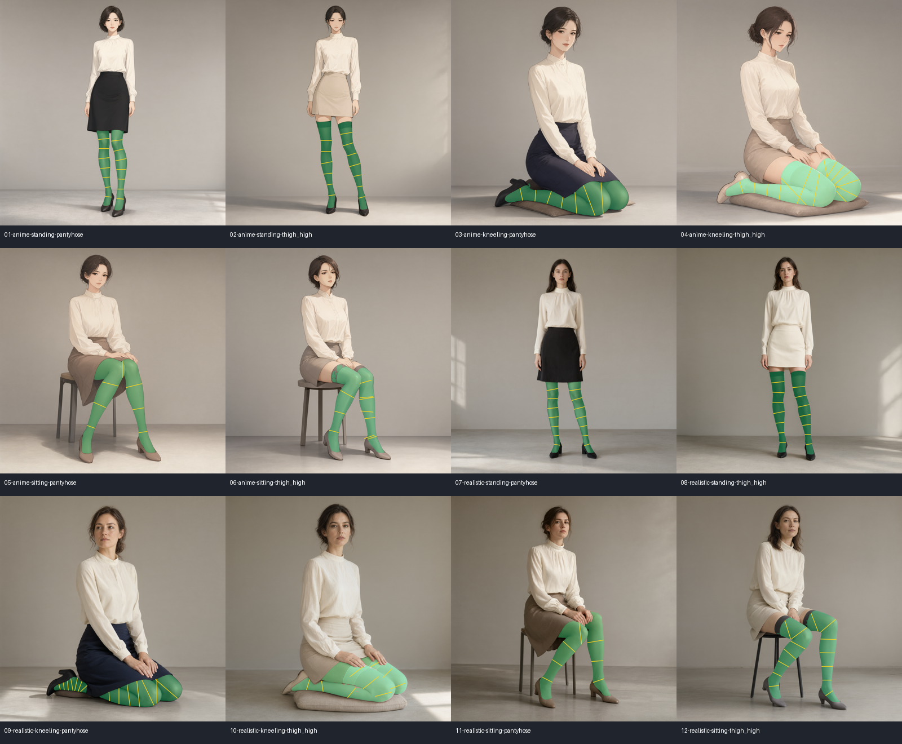
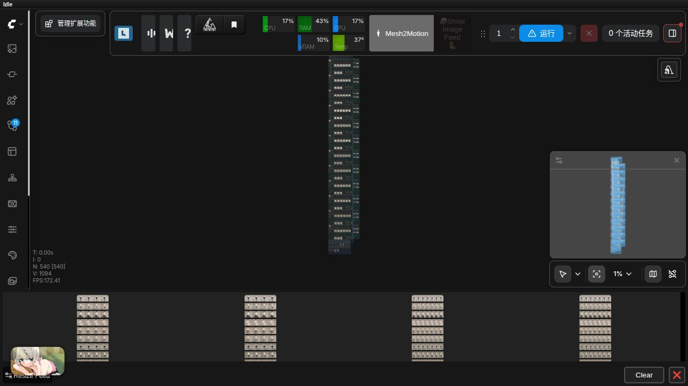

# 2026-10-11 Qwen 2.1 原生方形高清丝袜测试

## 撤销旧素材并重新筛选

旧 2048×3072 人物语料存在多肢与腿部错接，整体撤销为合格示例。旧轮次的像素检查只能证明渲染约束，不能证明生成素材质量。本记录、素材清单、19/20 工作流和截图已改为新的 2048×2048 语料。

使用本地 Qwen Image 2.1 BF16、Qwen3-VL 8B、Qwen 2.1 VAE，Euler/simple、25 步、CFG 1。直接生成 **2048×2048**，没有缩图后放大或超分步骤；不下载模型，不调用远端服务。模型路径和实际提示词、种子、任务 ID、图片 SHA256 与一体化图片身份见 [素材清单](../../examples/stocking_texture/hd/dataset_manifest.json)。

本轮生成 14 张候选，最终采用 12 张。首版第 03 张跪姿候选小腿向相反方向错接，明确拒收；第 04 张随跪姿提示词修订一并重生成。两张候选移至独立排错目录，不进入固定 input、工作流或文档图片。跪姿改为正面三分之四视角、双膝并排、小腿自然向后折叠；背景简化为单人摄影棚。

12 张逐张检查人物数量、手臂/腿数量、膝盖连接和脚部重复，未发现明显多肢或错接。此检查不代表遮挡处或精细手指完全无瑕疵。素材涵盖二次元插画/写实 × 站姿/跪姿/坐姿 × 连裤袜/大腿袜，包含深浅颜色和曲腿。写实图片仍由模型生成。

## 输入与引导

固定输入为 `ComfyUI/input/tb_stocking_square_*.png`，使用 input 根目录中的独立文件名，以便标准 LoadImage 图片选项直接识别。原始生成图在 `output/ToolBoxStocking/Square-Qwen21/`，对比结果在 `output/ToolBoxStocking/Square-compare/`。原始大图留在本地。

全部选区、深度与走向重新生成，未沿用旧人物图的引导。SAM3 默认阈值 0.4；第 10 张浅色跪姿大腿袜默认未识别，降至 0.2 后检查遮罩。第 06、10 张合并相邻分割碎片、清除小孤立碎片，不向选区外扩大覆盖；补充膝盖和第二条小腿的横向引导。袜口的细碎边界仍可继续手工修边。

## 工作流与真实执行

[19-Qwen21 原生高清素材生成](../../examples/stocking_texture/hd/19-Qwen21原生高清测试素材生成.json) 为 63 节点、12 个原生方图分支，共用本地模型加载器。

[20-高清多场景丝袜纹理与图层对比](../../examples/stocking_texture/hd/20-高清多场景丝袜纹理与图层对比.json) 为 540 节点。每图共用编辑器、深度和一次几何求解，比较 knit、loops、lines、grain、oily、coil 六种基础织物及 Coil＋蕾丝、油光＋豹纹/PARIS、爱心＋两个文字层＋摩尔纹＋随机/手工损伤三组组合。共保存 108 个完整成品、12 个柔和透明图层、24 个逐场景比较条与两份总览。512×512 缩图只用于总览。

| 队列 | 任务 ID | 结果 | 耗时 |
| --- | --- | --- | --- |
| 第一轮 API 大工作流 | `b9906f89-8de9-49b1-9c19-e51cc58bc0f1` | success，292 个输出节点 | 449.6 秒 |
| 第二轮 ComfyUI 界面提交 | `39d96d4f-566b-4a10-83d3-90a925b97006` | success，292 个输出节点 | 400.4 秒 |

新增输入图片后，已打开的页面可能仍保留旧图片选项并显示“缺少输入”提示；应重新加载页面并从磁盘打开更新的 20。此次界面提交的实际任务包含全部 12 个 `tb_stocking_square_` 输入，并执行成功，原图预览也可读取。已保存工作流与原有用户工作流分开管理，没有改动模型或数据库。

[查看十二场景组合效果总览](../images/stocking_hd_overview.png)

## 验收结果

| 检查 | 结果 |
| --- | --- |
| 素材人物结构 | 12 张逐张检查，明显错接候选已排除 |
| 12×9 个成品尺寸 | 全部 2048×2048 |
| 各场景九种材质 | 输出 SHA256 互不相同，均产生纹理变化 |
| 遮罩外像素 | 108 个输出与原图逐像素一致 |
| 柔和透明 PNG 重合成 | 12 个图层每通道最大误差 ≤1 灰阶 |
| 512×512 裁剪预览 | 12 场景均与完整成品对应区域逐像素一致 |
| 实际队列 | API 和界面提交两轮均 success |
| API / 界面复跑 | 108 个成品逐像素一致 |

详细逐图结果、输出文件名与修改像素数见 [机器可读验收记录](stocking_hd_2026-10-11.json)。本轮调整示例、素材及引导，没有修改渲染器代码，未重复运行与此次数据更换无关的全部单元测试。

油光反射仍较强，实际使用时应调整强度；曲腿和重叠处的纹理形变仍取决于选区与走向。以上通过项是固定语料的人物初筛、实际执行和像素约束验收，并非对任意图片的全自动分割或视觉质量保证。

## 使用

本地工作流列表 `ToolBox/StockingHD` 中打开更新的 19、20。19 重新生成仅写入 output；采用新图片前必须检查人物结构，以素材清单中的名字导入 input，并重新编辑选区和走向。保留图片指纹绑定，不能直接复用另一张图片的旧引导。材质配置集中在 20 顶部，完整输出按场景保存。早期预览会话可能被回收，可重新单独执行对应分支。

English: the former 2048×3072 corpus is withdrawn because of extra limbs and incorrect leg connections. Fourteen native 2048×2048 Qwen Image 2.1 candidates were generated locally; twelve were accepted after visual inspection. One malformed kneeling candidate and one superseded candidate were excluded. Masks, depth and guides were rebuilt, with lower-threshold segmentation and manual guide review for light hosiery. The 540-node matrix ran successfully through both the API (449.6s) and the ComfyUI interface (400.4s). All 108 outputs preserve exterior pixels exactly; all twelve PNG layers composite within one level, and all twelve native crop previews match exactly. Prompts do not guarantee anatomy, and occluded limbs/fine fingers are not fully verified. No renderer code, models or databases were changed. Reload stale frontend image lists after adding the new fixed input files.
