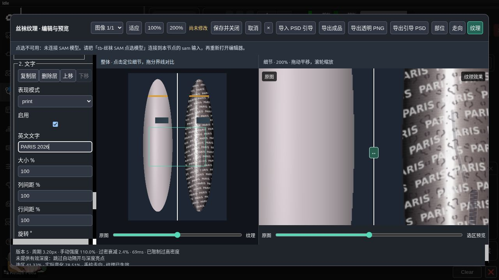
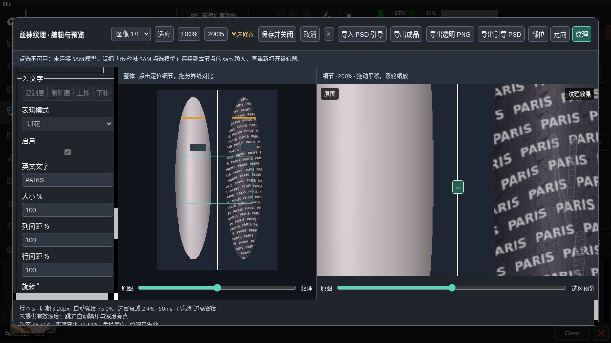

# 2026-10-11 丝袜有序材质架构验收与性能记录

环境：既有 `comfyui-test-cu130-megapak-pt211` 容器，Python 3.13、Torch 2.11 CUDA 13.0；CPU 上的 NumPy/Pillow 渲染。使用项目公开合成图片，未改变模型、数据库及已有用户工作流。新增示例独立放在 `ToolBox/StockingMaterials`。

## 四阶段验收

| 阶段 | 检查与结果 |
| --- | --- |
| 1 共享接口与迁移 | 共享 JSON 定义驱动后端校验、前端控件和配置节点；14 个 V1 样式（含 Coil）在织物/印花两种表现下含文字/损伤/遮挡，迁移 V2 与原算法逐像素相同；未来版本拒绝读取；保留旧参数与端口顺序。 |
| 2 基础织物与有序图层 | Coil＋蕾丝、多文字、顺序差异、停用、稳定 ID 与 16 层上限通过；文字方向、遮罩外原像素及透明合成通过。 |
| 3 部位覆盖 | 左右腿不同织物与图层；另一部位输出不变；材质变化几何缓存命中；分割复制与合并目标归属、图片隔离、撤销/重做、取消、保存重开通过。 |
| 4 分层缓存与裁剪 | 调颜色/不透明度复用采样；改变一层尺寸仅该层失效；排序复用全部采样；缓存超限跳过仍像素一致；全图与 ROI 相同。测量三种分辨率，未设速度门槛。 |

自动测试：后端 159 项及 5 个子测试、前端 36 项通过，共 195 项及 5 个子测试；无跳过。

## 实际 ComfyUI 验证

运行 15–18 四份新工作流，正式队列与编辑器预览相同；每份裁剪 `[80,100,400,600]` 与全图对应区域逐像素相同；柔和 PNG 每通道重合成误差 ≤1。18 连接五个新节点，服务端全局材质具有优先权，浏览器显示解析值并只读，当前部位仍可编辑。高级分步流程也接入同一材质配置并验证裁剪。

重新运行 06–09 四份旧效果工作流及高级旧渲染流程，替换图层重合成精确一致，透明 PNG 有效。回归包含种子复现、批次成功/失败索引、PSD/PSB 中英文引导往返、预设/草稿用户隔离。V2 草稿保存后重启容器再恢复，预览与重启前相同。

浏览器实际检查：复制全局图层、添加文字、修改文本、启用、上移、撤销、重做、取消与重开；保存后的 `PARIS 2026` 文字层再次打开仍启用。200% 细节预览正常。高级渲染窗口另验证将种子改为 7 后取消，重开仍为原种子 20261005；保存按钮有效。另修复材质连接遗漏于快捷底图准备路径的问题。






## 性能测量

脚本 `scripts/benchmark_stocking_materials.py`；每种尺寸独立进程、V1/V2 顺序测量。几何单独求解并报告；每场景 5 次，P95 为这五次的百分位数。冷渲染清空场景/最终效果/采样/损伤缓存，保留已求解几何和图集；重复、单文字层颜色调整及中央四分之一 ROI 复用全图表面与随机布局。峰值 RSS 是整个测量进程的累计高水位，包含导入、几何、场景、临时数组和两版本，不等于缓存字节数。旧缓存未记录命中计数，填“—”；V2 命中率分别为图层采样和最终合成。

| 尺寸 | 版本 | 场景 | 中位 ms | P95 ms | 峰值 RSS MiB | 采样命中 | 最终命中 |
| --- | --- | --- | ---: | ---: | ---: | ---: | ---: |
| 1920×1080 | V1 | 冷渲染 | 1765.7 | 1791.3 | 1214 | — | — |
| 1920×1080 | V1 | 重复预览 | 160.3 | 242.5 | 1214 | — | — |
| 1920×1080 | V1 | 单层颜色 | 1166.6 | 1288.5 | 1239 | — | — |
| 1920×1080 | V1 | 1/4 ROI | 69.7 | 840.2 | 1244 | — | — |
| 1920×1080 | V2 | 冷渲染 | 1689.4 | 1736.3 | 1246 | 0% | 0% |
| 1920×1080 | V2 | 重复预览 | 129.7 | 132.6 | 1246 | — | 100% |
| 1920×1080 | V2 | 单层颜色 | 323.6 | 327.6 | 1246 | 100% | 0% |
| 1920×1080 | V2 | 1/4 ROI | 148.8 | 301.3 | 1246 | 0% | 80% |
| 2560×1440 | V1 | 冷渲染 | 3033.3 | 3082.5 | 1713 | — | — |
| 2560×1440 | V1 | 重复预览 | 268.6 | 272.2 | 1713 | — | — |
| 2560×1440 | V1 | 单层颜色 | 1762.2 | 1793.0 | 1766 | — | — |
| 2560×1440 | V1 | 1/4 ROI | 130.5 | 1358.3 | 1766 | — | — |
| 2560×1440 | V2 | 冷渲染 | 3194.8 | 3233.0 | 1769 | 0% | 0% |
| 2560×1440 | V2 | 重复预览 | 236.3 | 237.3 | 1769 | — | 100% |
| 2560×1440 | V2 | 单层颜色 | 577.4 | 599.0 | 1769 | 100% | 0% |
| 2560×1440 | V2 | 1/4 ROI | 266.5 | 517.2 | 1769 | 0% | 80% |
| 3840×2160 | V1 | 冷渲染 | 6939.8 | 7227.9 | 3083 | — | — |
| 3840×2160 | V1 | 重复预览 | 574.9 | 584.9 | 3083 | — | — |
| 3840×2160 | V1 | 单层颜色 | 4176.1 | 4200.5 | 3095 | — | — |
| 3840×2160 | V1 | 1/4 ROI | 287.5 | 3216.4 | 3095 | — | — |
| 3840×2160 | V2 | 冷渲染 | 6895.9 | 7003.3 | 3210 | 0% | 0% |
| 3840×2160 | V2 | 重复预览 | 496.6 | 510.7 | 3210 | — | 100% |
| 3840×2160 | V2 | 单层颜色 | 1304.7 | 1358.1 | 3210 | 100% | 0% |
| 3840×2160 | V2 | 1/4 ROI | 599.0 | 1190.9 | 3210 | 0% | 80% |

几何求解时间：1920×1080：2.13s；2560×1440：4.27s；3840×2160：12.95s。

缓存仍使用原总预算：部位几何 256 MiB、场景 1 GiB、预览会话 512 MiB、效果合计 128 MiB、图集 16 MiB。三次测量结束的场景和效果缓存字节记录在 [原始 JSON](stocking_materials_benchmark_2026-10-11.json)。4K 中较大的单项可跳过缓存，允许命中率下降。

V2 的单层颜色调整明显减少重复采样；冷渲染与 ROI 并非所有尺寸都比 V1 快。ROI 尚有全图基础光照和诊断统计开销，本轮按计划记录结果，不以耗时设通过门槛。

## 复现

```bash
python -m pytest --confcutdir=tests tests -q
node --test tests/stocking*.test.mjs
python scripts/test_stocking_effects_api.py
python scripts/test_stocking_material_api.py
# 重启当前测试容器，再验证草稿恢复
python scripts/test_stocking_material_api.py --restore
python scripts/benchmark_stocking_materials.py
```

English: all four stages retain existing node inputs/outputs and V1 pixel behavior. The four public V2 workflows and the advanced material connection pass real queues, exact ROI matching and soft PNG composition within one level. Browser checks cover linked global read-only values, editable region layers, undo/redo, cancellation and saved reopening. Recovery survives a container restart. Measurements use five CPU samples per scenario, reporting median/P95 and cumulative process RSS; cache budgets are unchanged. Color edits reuse sampling, while cold rendering and ROI are not uniformly faster. No speed pass threshold is applied.
