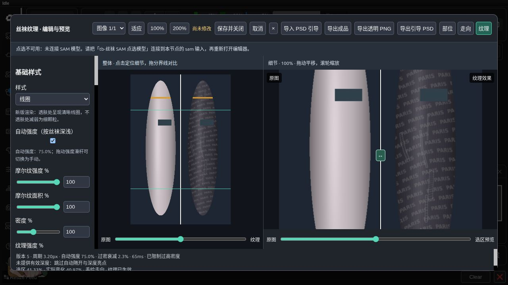
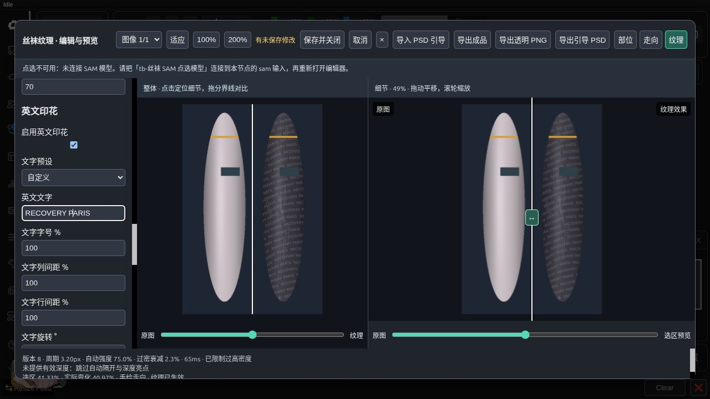

# 上游丝袜能力验收 · 2026-10-11

基线：上游 `f74c8ac0190ec43b2cdfcb13db86f35a83283311`；兼容渲染器保持 `ad4cc92`。测试容器为 `comfyui-test-cu130-megapak-pt211`，torch 2.11.0+cu130；PSD 依赖 psd-tools 1.24.0。全部图像采用项目公开合成素材，没有使用用户插画。

## 自动检查

- 后端完整套件：**123 passed**，另有 **5 个子测试通过**。覆盖旧输出、遮罩外原像素、裁剪、随机种子、缓存、批次索引及原 PromptWriter 测试。
- 前端 Node.js 套件：**31 passed**。覆盖旧草稿语义、图片绑定、坐标、参数、指针路径删除、像素归属与亮点关联。
- 新版渲染覆盖 Coil 透肤变化、摩尔纹强度/面积、新旧油光差异、遮挡填充、与花纹/文字/损伤组合，以及柔和图层。浮点重合成最大误差符合 `1e-6`；PNG 每通道误差不超过一个灰阶。
- 分割、合并、清空、镜像、路径裁剪、自动隔开删除重开、参数验证、不可读预设保留、用户存储隔离和草稿容量回收检查通过。
- 中文/英文引导层与 PSD/PSB 往返检查通过，部位遮罩、颜色、走向、手工隔开和亮点得以恢复。

## 实际队列和接口

| 工作流 / 场景 | 结果 |
| --- | --- |
| 10 Coil | 正式队列成功，细节预览与正式裁剪逐像素一致 |
| 11 深度摩尔纹 | 正式队列成功，预览裁剪一致；切换深度方向后导出与预览一致 |
| 12 新旧油光 | 两个渲染器均成功，预览裁剪一致 |
| 13 柔和图层组合 | 蕾丝、PARIS 和损伤成功；队列重合成最大误差 1 灰阶 |
| 14 PSD 往返 | 导入、渲染与新的引导 PSD 导出成功 |
| 编辑器三种导出 | 成品 PNG、柔和透明 PNG、引导 PSD 均成功；PNG 重合成最大误差 0 |
| 导入导出的 PSD | 同底图匹配，两部位与引导恢复成功 |
| 编辑 / 预设接口 | 自动分割、材质预设保存、读取、删除成功 |
| 七路对比 | 原图＋六种基础样式成功；采用公开手工选区，验证七路拼接而无需加载识别模型 |
| 旧 06–09 工作流 | 四个花纹/文字/损伤工作流成功，旧图层精确重合成、RGBA 和高级预览一致性通过 |
| 容器重启恢复 | 磁盘草稿成功恢复，预览与重启前逐像素一致 |

## 浏览器交互

实际检查了自动分割生成第三个部位、撤销恢复两个部位、重做、轮廓镜像、切换新版 Coil 与柔和图层、保存并重开恢复参数、恢复默认再撤销。导出的工作流含 27 个输入控件值，末尾是六个新增选项，未混入状态或操作按钮。

将未提交文字改为 `RECOVERY PARIS` 后，服务器自动写入独立草稿。关闭浏览器标签页并重新打开已保存的测试工作流，编辑器显示恢复/丢弃入口；恢复后文字仍为 `RECOVERY PARIS`。取消后重新打开，节点文字保持 `PARIS`，且不再出现恢复入口。

测试副本保存在 `ToolBox/StockingEffects/_tests/stocking-upstream-ui-2026-10-11.json`。原 `ToolBox/StockingEffects/09-花纹文字损伤组合.json` 与仓库原示例 SHA-256 一致：`ea99160c9bfdebab38cb288f792d5f622cade7a7fc615efcd65f0a1a56107a66`。

## 部署与使用边界

54 个部署文件（含字体与许可）与本地 SHA-256 一致，ComfyUI 仅发现一个丝袜前端入口。节点与前端已部署并重启现有容器，没有重建容器或改变挂载配置。模型、数据库及现有用户工作流保留；五个新 UI 示例安装到 `ToolBox/StockingUpstream/`。

旧工作流缺少新选项时仍用 `legacy` 和 `replacement`。使用 Coil、摩尔纹和新版油光需显式选择新版；摩尔纹还需要有效深度。PSD 是引导交换格式，文字、损伤和材质参数继续保存在 ComfyUI 工作流中；实验性纹理 PSD 不开放。预设、自动草稿保存位置与额度见[使用文档](../stocking_texture.md)。

运行证据保存在被 Git 忽略的 `data/stocking_upstream_validation/`，包括后端/前端日志、API 结果、重启恢复结果、浏览器检查、部署文件哈希和导出素材。复现脚本：`scripts/test_stocking_upstream_api.py`（首次运行保存测试草稿；重启后加 `--restore` 验证）、`scripts/test_stocking_effects_api.py`。

## 对比与截图

