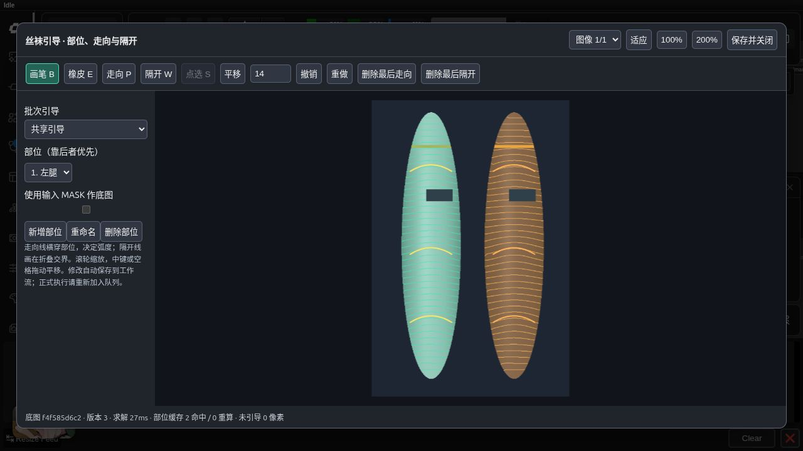
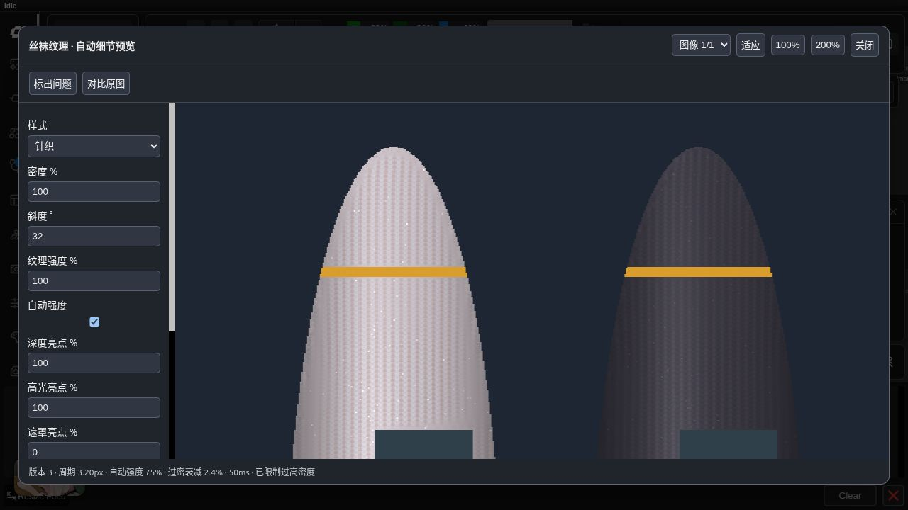

# 丝袜纹理节点验收记录 · 2026-10-09

实现位于 ComfyUI-ToolBox 的 `nodes/stocking_texture` 与 `web/js/stocking_texture.js`。
上游算法基线为 `ad4cc92de86021f20bedcf9de5b27ec0ae574184`。

## 环境与结果

实际环境：ComfyUI 0.39.0、前端 1.53.10、Python 3.13.12、Torch 2.11.0+cu130、RTX 5090 D。
NumPy 2.3.2、SciPy 1.17.1、OpenCV 4.13.0、contourpy 1.3.3、Pillow 12.3.0、Transformers 5.18.0。

- 后端 pytest：32 项通过，无跳过；原有 PromptWriter unittest：8 项通过。
- 前端坐标与版本判断：3 项 Node 测试通过；Python/JavaScript 语法及 Git whitespace 检查通过。
- 新目录独立插件导入注册五节点成功；已有持久化 ToolBox 安装更新并重启后注册与路由成功。
- manual、external-depth、sam、batch 四份真实 API 工作流执行成功；批次输出四张成品和四张透明图层。
- 各工作流的透明图层重合成逐像素等于成品；服务端裁剪预览等于保存图对应区域；旧 revision 请求被拒绝。
- 内置 Small 深度节点也完成真实 ComfyUI 队列执行，模型文件安装在测试环境的 models 目录，未加入源码仓库。

详细数据：[API 验收](stocking_api_2026-10-09.json)、[性能数据](stocking_benchmark_2026-10-09.json)、
[深度推理](stocking_depth_2026-10-09.json)、[上游核心对照](stocking_core_comparison_2026-10-09.json)。

## 数值、接口与交互覆盖

测试覆盖五种样式、RGB/BGR 转换、遮罩外原始浮点像素、透明图层合成、裁剪一致性、引导疏密不改变间距、
遮挡前后相位一致、折腿隔开与膝盖过渡、ripmap 各向异性过滤、过密衰减、随机种子、亮点随数量增加保留位置、
纹理强度不缩放亮点增亮比例、颜色排除、浅色自动强度、纯色油光不虚构高光、单图与批次一致。

异常覆盖空部位、无引导、小图、NaN/Inf、非法 JSON、尺寸与批次数不匹配、伪彩色深度、常量深度、模型缺失和越界模型路径。
缓存覆盖单部位重算、渲染不重新求解、100 次参数预览、字节上限、淘汰后的队列缓存失效，以及不同工作流共用节点 ID。

真实浏览器中已验证加载示例、绘制走向、局部重算、撤销/重做、切换针织样式、200% 细节预览。
通过 ComfyUI 导出并重新加载工作流，确认隐藏的 guides_json 包含两部位 PNG 遮罩及各三条走向线，渲染样式也正确恢复。
重新执行和打开编辑器后，引导与等值线恢复正常。

## 模型与性能

SAM ViT-B 真实权重推理成功，三个候选按面积排序。GPU/CPU 候选联合 IoU 约 0.99997；
推理后模型与 embedding 均在 CPU。Small-hf 深度输出有限、范围 [0,1]、尺寸 [1,384,256,3]，
CPU/GPU 相关系数约 0.99999999；两种设备推理后模型均回到 CPU。

下表为生成样例的纯 CPU 求解和热缓存 512×512 裁剪渲染，不包括 HTTP/PNG 编码与浏览器绘制。
批次样例复用相同构图，因此部位求解和图像场景缓存可以共享。测量不是任意真实图片的速度承诺。

| 分辨率 | 批次 | 冷求解秒 | 五样式热裁剪中位数范围秒 |
|---|---:|---:|---:|
| 832×1216 | 1 | 2.03 | 0.094–0.140 |
| 832×1216 | 4 | 1.33 | 0.075–0.139 |
| 1280×1920 | 1 | 3.35 | 0.112–0.171 |
| 1280×1920 | 4 | 4.23 | 0.120–0.177 |
| 3840×2160 | 1 | 12.83 | 0.217–0.344 |
| 3840×2160 | 4 | 14.56 | 0.222–0.320 |

此基准渲染/求解的 CUDA 分配为 0；累计进程峰值 RSS 约 6.31GiB（含四张 4K 图、所有输出、缓存与临时工作数组）。
缓存上限与瞬时工作内存不同；超过预览会话预算的大批次仍能队列渲染，需要分批获得交互预览。

六个核心文件与固定提交逐字节一致；look.py 只增加默认兼容的种子参数。
1280×1920 合成部位的独立上游/迁移核心求解输出逐元素一致，三次计时中位数比为 1.0124，满足增加不超过 20% 的目标。

## 修复与验收边界

迁移修复了加濑风/油光遮罩外的灰度变化、无引导 1×1 图的梯度异常、NumPy 2 标量提升导致 OpenCV remap 类型不匹配、
渲染预览初始化、缓存淘汰后仍引用过期 UI 会话，以及多工作流共享节点 ID 的失效判断。

图像均为项目生成的公开合成用例。未使用或要求上游未公开样图。
真实插画中黑白丝袜、透肤、复杂遮挡、折腿和油光的人工视觉验收尚未完成；油光仍为试验样式。
PSD 工程导入导出、镜像/自动部位分割和视频时序稳定按首版范围未实现。
