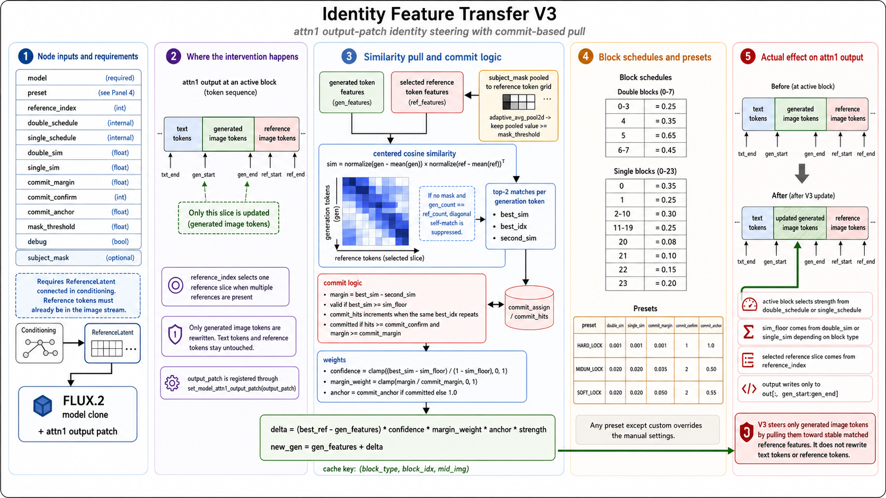

# FLUX.2 Klein 原始示例

这里收录本地备份中的全部 8 份 JSON 工作流，文件内容保持不变。打开前请更新 ToolBox、停用独立原插件并重启 ComfyUI。使用方法见 [节点说明](../../docs/flux2_klein.md)。

| 工作流 | 内容 |
| --- | --- |
| [ref__latent.json](ref__latent.json) | 文本/参考平衡与单参考控制 |
| [iden_wf (1).json](<iden_wf (1).json>) | Identity Guidance 与基础身份迁移 |
| [adv_wf.json](adv_wf.json) | Advanced 身份迁移 |
| [iden_transfer_v3.json](iden_transfer_v3.json) | V3 身份迁移 |
| [Iden_feat_final_fixed.json](Iden_feat_final_fixed.json) | Final 多参考与主体遮罩 |
| [Iden_feat_final_fixed_sigma.json](Iden_feat_final_fixed_sigma.json) | Final 多参考与 SIGMAS 调度 |
| [Sample_color_anchor.json](Sample_color_anchor.json) | 多参考控制与颜色锚定 |
| [Flux2Klein_Ksampler_exp.json](Flux2Klein_Ksampler_exp.json) | 实验采样器与标准采样链对照 |

## 运行前准备

- 示例默认使用 `flux-2-klein-9b.safetensors`、`qwen_3_8b_fp8mixed.safetensors`（CLIP 类型为 `flux2`）和 `flux2-vae.safetensors`。请在对应加载器中选择你已安装的匹配模型。
- 所有工作流都含有 `LoadImage`；原图片和 `clipspace/clipspace-painted-masked-*.png` 未随备份提供。请替换为自己的参考图，Final 示例还需重新绘制或载入主体遮罩。
- 除 `ref__latent.json` 外，其余七份含 `Image Comparer (rgthree)`，需 rgthree-comfy；也可手动改用预览节点。
- 两份 Final 示例还含 `GetImageSize+`，需 ComfyUI_essentials；也可手动替换为提供相同宽高输出的节点并重新连线。
- 其他节点属于 ComfyUI 的模型加载、编码、参考 conditioning、FLUX.2 调度及采样功能；请使用包含这些节点的 ComfyUI 版本。
- 原示例包含 `SaveImage`，执行后会写入 ComfyUI 输出目录。运行前检查文件名前缀及保存设置。

这些文件是保留原貌的迁移示例，需要完成上述配置后执行；不会自动下载缺少的模型、图片或第三方插件。

## 原始说明图

